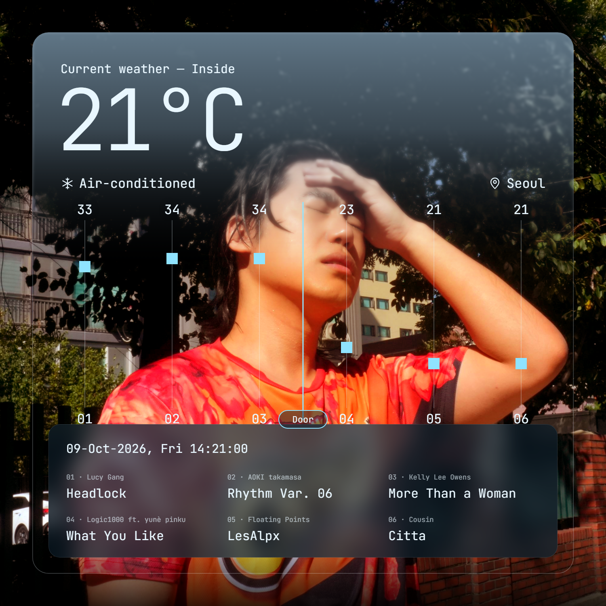
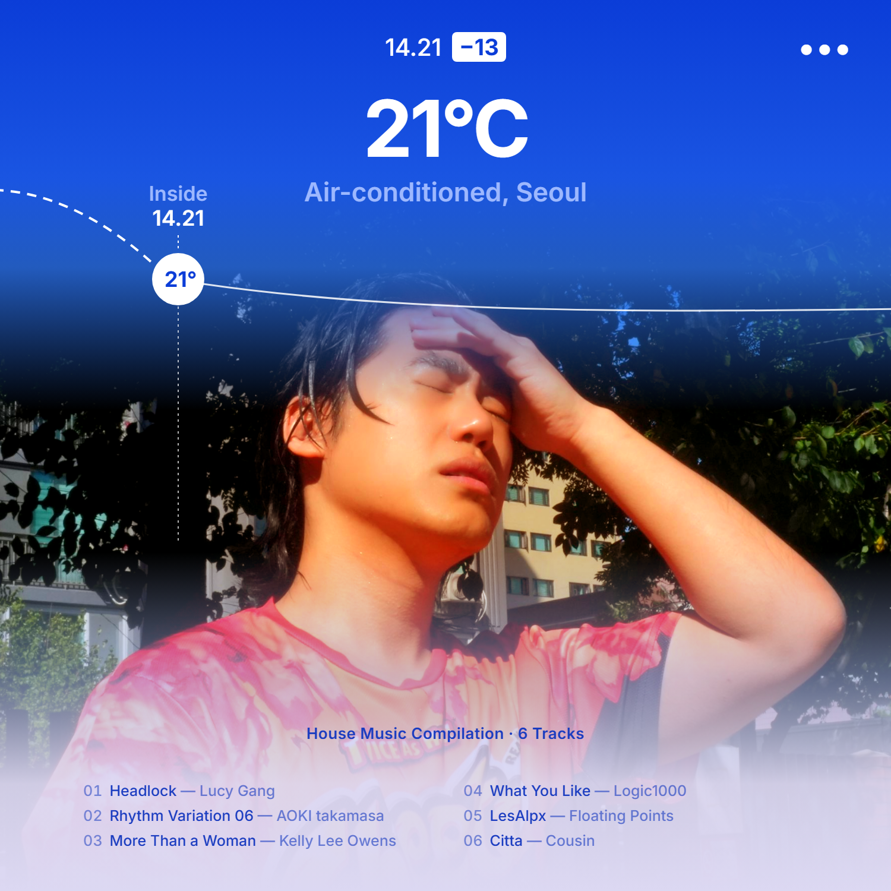
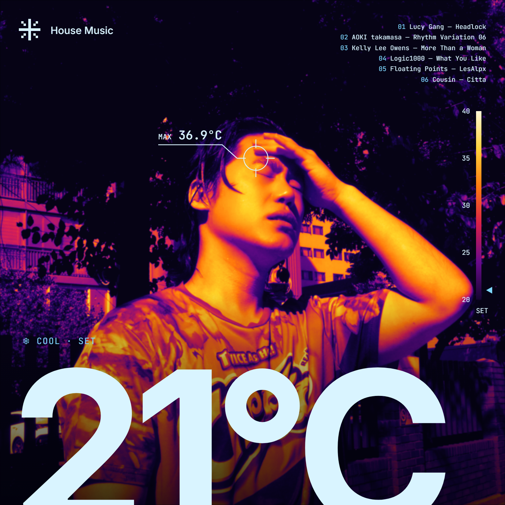
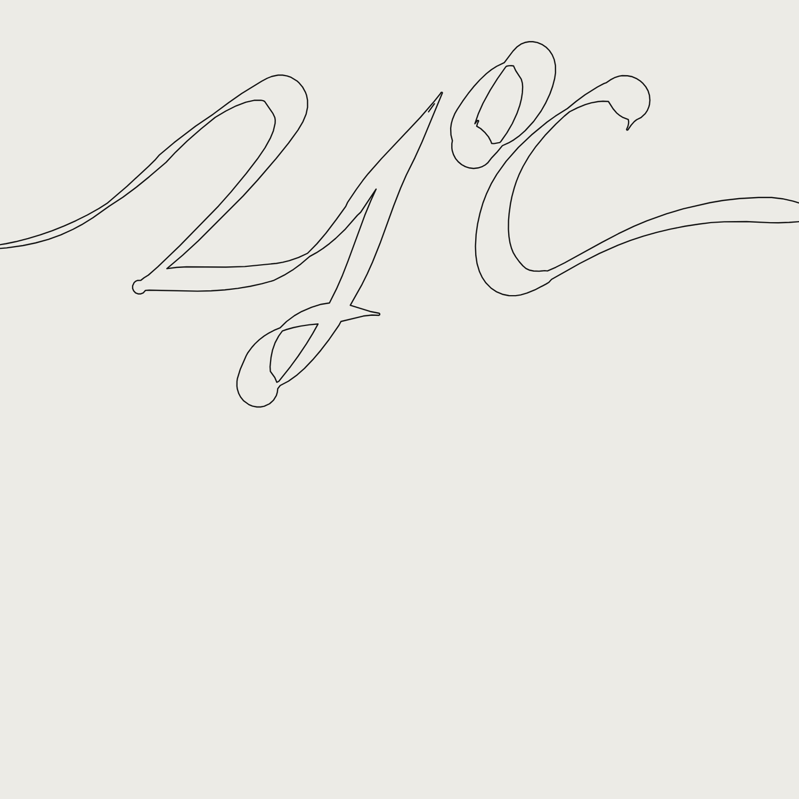
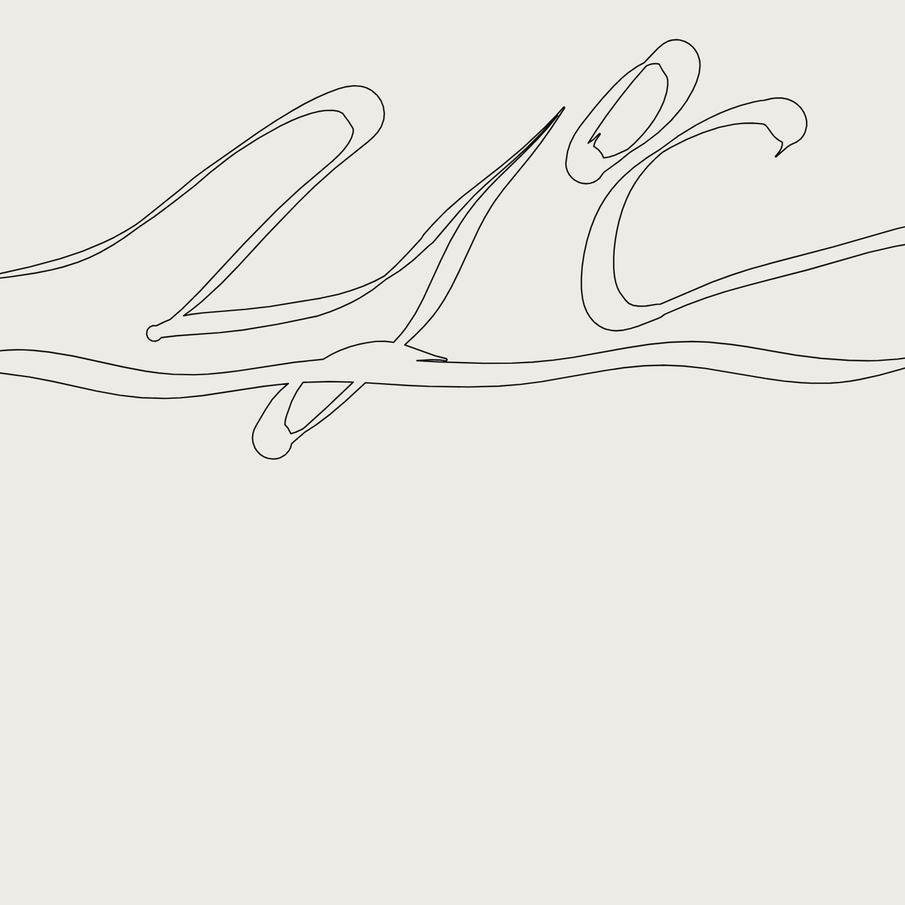
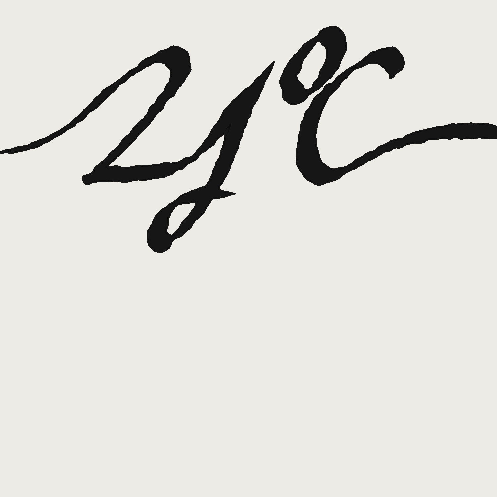
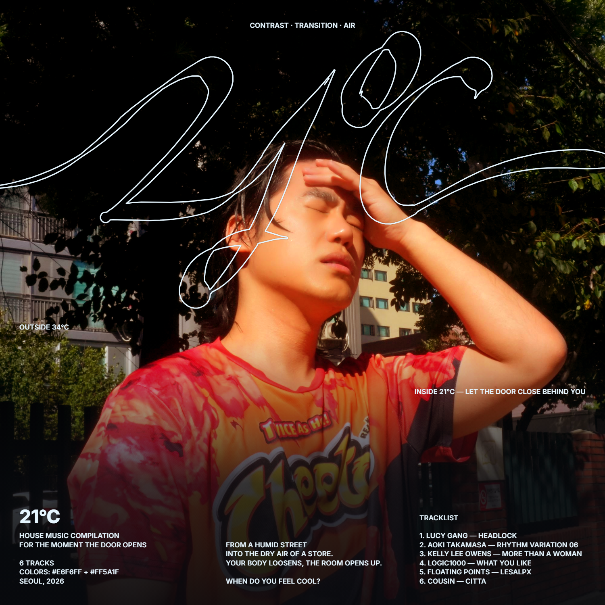

# 1009 — 날씨 UI 레퍼런스로 커버 시안 3종

## 오늘 한 일
- 2차 사진 `photos/11.jpg`(치토스 티셔츠, 이마에 손)로 사용자가 만든 편집본(`drafts/v00_user-edit.png`)을 검토했다
- 레퍼런스 두 개를 정리했다: DOSS 파티 포스터(정보 배치), 날씨 앱 UI 두 종(모노 카드형, 파란 하늘 곡선형)
- 날씨 UI 문법으로 시안 3종을 만들었다 (HTML로 만들고 1500px PNG로 출력)

## 결과물

| v01 Current weather | v02 Today curve | v03 Thermal HUD |
|---|---|---|
|  |  |  |

- **v01 Current weather** (왼쪽 모노 카드 레퍼런스): 카드 위쪽에서 냉기 안개가 내려온다. 트랙 6곡을 시간축으로 놓고, 03과 04 사이 `Door`에서 34°가 23°로 떨어진다. 하단 패널은 날짜 + 트랙리스트
- **v02 Today curve** (오른쪽 파란 하늘 레퍼런스): 위는 파란 실내 공기, 아래는 연보라 안개, 가운데 띠만 뜨거운 사진. 바깥(점선)이 떨어져 `21°` 원에 닿은 뒤 평평하게 유지된다. 상단 배지 `−13` = 34°에서 21°로의 차이
- **v03 Thermal HUD**: 사진을 열화상 팔레트로 바꾸고(덥게), 이마 계측값 `MAX 36.9°C`, 온도 스케일, `COOL · SET 21°C`를 얼음색으로 선명하게 얹었다(시원하게)

### 타이틀: 외곽선 스크립트 (OVVN·WGT 레퍼런스)

| t01 Outline flow | t02 Outline airflow | t03 Ink melt |
|---|---|---|
|  |  |  |

- 21°C의 획 뼈대를 베지어로 그리고, 브로드닙 펜처럼 방향에 따라 굵기를 바꾼 뒤 획을 합쳐 **외곽선 한 줄**만 남겼다 → [`title/make_title.py`](title/make_title.py)
- **t01**: 레퍼런스에 가장 가까운 기본형 / **t02**: 가로로 더 늘리고 바람결 획을 추가 / **t03**: 비교용 번진 잉크
- **c01**: 뜨거운 사진 위로 얼음색 외곽선이 지나가게 했다. 작은 정보는 OVVN처럼 대문자 한 크기(키워드, 바깥 34°C / 안 21°C, 소개, 트랙리스트)로 통일
- `*_ice.svg`는 배경 없는 얼음색 버전이다. 일러스트레이터에서 열어 패스를 직접 다듬을 수 있다

## 피드백 / 고민
- **외곽선 타이틀 = 공기·바람결 = 시원한 그래픽, 잉크 = 녹아내리는 더위.** 기획 전략에는 외곽선 쪽이 맞다 (LO3)
- c01에서는 얇은 냉기 선이 달아오른 얼굴과 손 위를 지나간다. '뜨거운 몸에 닿는 에어컨 바람'으로 읽힐 수 있다
- 코드 타이틀은 탐색용이다. LO2(레퍼런스 없이 스케치)를 위해 손 스케치를 함께 남겨야 한다
- **세 시안 모두 '사진은 덥게, 그래픽은 시원하게'를 다른 방식으로 나눈다** (LO3): v01은 위·아래(안개), v02는 띠(샌드위치), v03은 재질(열화상과 선명한 UI)
- **'전환' 키워드가 가장 직접적으로 보이는 시안은 v01**이다. `Door` 선 하나로 기획 첫 문장인 '문을 열고 들어선 순간'이 그래프가 된다
- **치토스 로고**: v01·v02는 패널과 안개로 낮췄고, v03에서는 "TWICE AS H"가 숫자 사이로 보인다. 열기 장치로 남길지 결정이 필요하다 (1007 보류 사항)
- 트랙별 온도 값(33→21)은 임의값이다. 곡의 BPM이나 분위기와 연결하면 근거가 생긴다

## 글로벌 파일에 반영할 것
- [ ] 합성 방향 후보에 '날씨 UI'(카드, 곡선, 열화상)를 추가할지 → CONCEPT.md
- [ ] 치토스 로고 처리 결정 → CONCEPT.md

## 다음 할 일
- [ ] 세 시안 중 방향 고르기 (기준: 대비·전환·공기 중 무엇을 가장 잘 보여 주는가)
- [ ] 트랙별 온도 값의 근거 정하기
- [ ] 파트너와 합친 초안 협의 (~1011 일)
