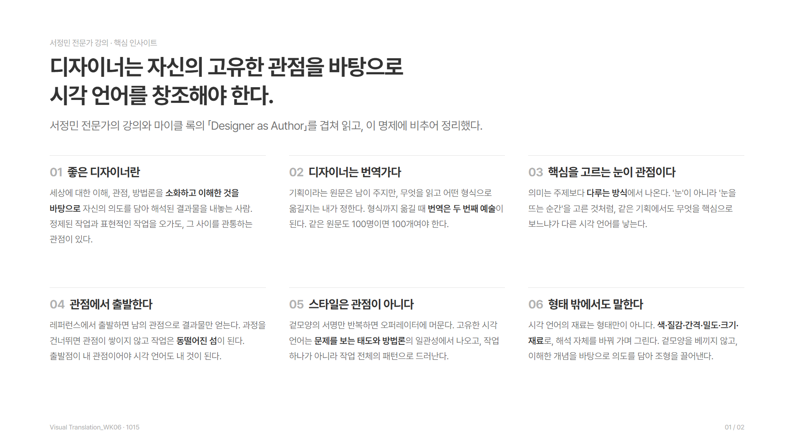
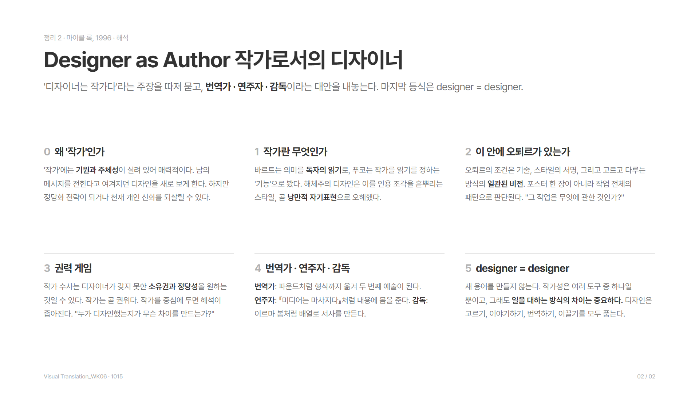

# 1015 — 번역가로서의 디자이너 (서정민 강의 · 「Designer as Author」)

## 오늘 한 일
- VT06 수업: 서정민 전문가 강의 → 팀별 키워드 스케치 피어 크리틱
- 녹취 기록에서 **서정민 전문가의 발언만** 골라 핵심을 정리했다 → [정리 1](#정리-1-서정민-전문가-발언-핵심)
- 웹페이지: https://yongzu.github.io/VT/1015/
- 정민님이 읽어 보라고 한 마이클 록(Michael Rock)의 「Designer as Author」를 단락별로 한국어로 풀어 정리했다 → [정리 2](#정리-2-designer-as-author-마이클-록-1996)
- 두 정리를 겹쳐 '디자이너는 자신의 고유한 관점을 바탕으로 시각 언어를 창조해야 한다'는 명제로 핵심 인사이트를 썼다 → [핵심 인사이트](#핵심-인사이트)
- 서정민 강의·핵심 인사이트를 한 장, 마이클 록 해석을 한 장, 이미지(1920×1080) 두 장으로 만들었다 → [cards/](cards/)

> 녹취는 음성 자동 변환이라 고유명사가 많이 틀려 있다. 문맥으로 바로잡았다:
> 칼레르스코 와이즈 → **Kaleidoscope Eyes**, 오큐트아트·어케트아트 → **Acute Art**, 피터 바스트·핀트레스 → **핀터레스트**, 계안 → **개안(開眼)**.
> "저만의 단점이 있다"는 앞뒤 맥락상 "저만의 **관점**이 있다"로 읽었다.

---

## 핵심 인사이트

> **디자이너는 자신의 고유한 관점을 바탕으로 시각 언어를 창조해야 한다.**
> 서정민 전문가의 강의와 마이클 록의 「Designer as Author」를 겹쳐 읽고, 이 명제에 비추어 정리했다.

1. **좋은 디자이너란.** 세상에 대한 이해, 관점, 방법론, 디자인에 대한 생각을 소화하고 이해한 것을 바탕으로, 자신의 의도를 담아 해석된 결과물을 세상에 내놓는 사람. 정제된 작업과 표현적인 작업을 오가도, 그 사이를 관통하는 관점이 있다. (서정민 · 좋은 디자이너의 정의)
2. **디자이너는 번역가다.** 기획이라는 원문은 남이 주지만, 무엇을 읽고 어떤 형식으로 옮길지는 내가 정한다. 파운드처럼 형식까지 옮길 때 번역은 두 번째 예술이 된다. 같은 원문도 100명이 옮기면 100개가 나와야 한다. 수업 이름이 '작가'가 아니라 Visual Translation인 이유다. (서정민 · 100명이면 100개 / 록 · 번역가 모델)
3. **핵심을 고르는 눈이 관점이다.** 의미는 주제보다 다루는 방식에서 나온다. 주제는 고르지 못해도 무엇을 핵심으로 볼지는 고를 수 있다. '눈'이 아니라 '눈을 뜨는 순간'을 고른 것처럼, 고르는 순간이 다르면 다른 시각 언어가 나온다. (서정민 · 개안 / 록 · treatment)
4. **관점에서 출발한다.** 레퍼런스에서 출발하면 남의 관점으로 결과물만 얻는다. 과정을 건너뛰면 관점이 쌓이지 않고, 작업들은 '나'를 중심으로 이어지지 않는 동떨어진 섬이 된다. 출발점이 내 관점이어야 시각 언어도 내 것이 된다. (서정민 · 낙하산과 섬 / 록 · 해체주의가 이론을 스타일로 베낀 일)
5. **스타일은 관점이 아니다.** 겉모양의 서명만 반복하면 오퍼레이터에 머문다. 고유한 시각 언어는 문제를 보는 태도와 방법론의 일관성에서 나오고, 작업 전체의 패턴으로 드러난다. "그 작업은 무엇에 관한 것인가?"에 답할 수 있어야 한다. (서정민 · 일관된 관점 / 록 · 내적 의미)
6. **형태 밖에서도 말한다.** 시각 언어의 재료는 형태만이 아니다. 색·질감·간격·밀도·크기·재료로, 해석 자체를 바꿔 가며 그린다. 겉모양을 베끼지 않고, 소화하고 이해한 개념을 바탕으로 의도를 담아 조형을 끌어낼 때 그 언어가 고유해진다. (서정민 · 스케치 피드백)

정리 이미지 2장: [cards/](cards/) — [01 서정민 강의 · 핵심 인사이트](cards/png/01_insights.png) · [02 마이클 록 해석](cards/png/02_rock.png)

---

## 정리 1. 서정민 전문가 발언 핵심

### 1. 번역가로서의 디자이너 — 이 수업을 설계한 이유
- 요즘 말하는 '초월 번역'에는 번역가의 주관과 의역이 들어간다. 디자이너도 **자아를 가진 번역가**로서, 자기 해석을 거쳐 자기 시각언어로 이야기를 전해야 한다.
- 이상적인 모습: 조건이 모두 같은 프로젝트를 디자이너 100명에게 맡겼을 때 **100개가 모두 다른 결과물**이 나오는 것. 그게 다양성이 존중되는 건강한 상태다.
- 단, 100개 모두 **목표는 달성해야 한다.** 목표에 닿는 길이 '나의 길', '나의 방법'이어야 한다. 이것이 번역가로서의 역할이다.

### 2. 레퍼런스를 출발점으로 삼는 위험 — '낙하산' 비유
- 수강생들이 저널링에서 레퍼런스 수집을 자기 '업'이라고 말해 충격을 받았다고 했다.
- 정민님도 레퍼런스를 많이 본다(핀터레스트 팔로워 1,500명). 대신 채널을 **전부 공개**해 둔다. 베끼면 남들이 알 수 있게 해서 스스로 베끼지 않으려는 장치다.
- 레퍼런스에서 출발하는 건 **목적지 섬에 낙하산으로 툭 떨어지는 것**과 같다.
  - 출발점에서 스스로 고민하며 가면 어떤 항구(마일스톤)를 거치는지, 시간·물품·비용이 얼마나 드는지, 내가 겪는 어려움이 무엇인지를 경험하며 나아간다.
  - 레퍼런스로 시작하면 그 마일스톤이 끊긴 채 결과물만 보게 된다. 과정을 이해하고 다시 밟아 보며 **배울 기회를 잃는다.**

### 3. 동떨어진 섬들 — 관점이 쌓이지 않는다
- "어차피 인터넷도 AI도 있는데 보면서 하면 되지 않나"는 반론은 일부 맞다. 하지만 그러면 결과물들이 **서로 동떨어진 섬**이 된다. **'나'라는 사람을 중심으로 이어지지 않는다.**
- 남이 거친 과정을 생략한 결과물을 기준으로 작업하므로 나와 작업 사이에 단절이 생기고, 디자이너는 **고유한 관점을 축적할 수 없다.**
- 좋은 디자이너에게는 직업적 가치관, 방법론, 문제를 바라보는 태도에 **일관성**이 있다. 채용할 때 포트폴리오에서 가장 많이 보는 것도 '이 사람의 일관된 관점이 있는가'다.
- "뭐든 다 할 수 있는 게 내 매력"이라는 목표도 말리진 않는다. 정민님도 정제된 작업부터 표현적인 작업까지 폭넓게 만든다. **그럼에도 자기만의 관점은 있다.** 그런 디자이너를 목표로 하라.
- 그렇지 않으면 **파편화된 결과물에 표현과 기술만 반복하는 오퍼레이터**가 되기 쉽다.

### 4. 좋은 디자이너의 정의
> 세상에 대한 이해, 관점, 방법론, 디자인에 대한 생각을 **소화하고 이해한 것을 바탕으로**, 자신의 의도를 담아 **해석된 결과물**을 세상에 내놓는 사람.

- 이것이 번역가로서 디자이너가 갖춰야 할 기본 스탠스다. 작업들을 관통하는 공통된 맥락(관점)을 스스로 선명하게 만들어야 한다.

### 5. 사례: 리움미술관 《Kaleidoscope Eyes》(2022) 포스터
**전시 조건**
- 프리즈 아트페어가 한국에 처음 들어오던 시점에 리움과 Acute Art가 함께 만든 AR 전시. 예술감독은 다니엘 비른바움(전 스톡홀름 현대미술관 관장, 베니스 비엔날레 총감독). 제프 쿤스, 올라퍼 엘리아슨, 아니시 카푸어 등이 참여했다.
- 스마트폰을 통해 **아무것도 없는 공간에서** 작품을 보는 전시. 실제 전시장이 없고, 리움 어디에서든(다른 전시장에서도) 볼 수 있다.
- 디지털 전시라서 **아무것도 물리적으로 만들지 않는다**는 조건: 포스터 인쇄 없음, 월 텍스트 없음, 리플릿 없음.

**핵심을 뽑아낸 과정**
1. 서문에서 핵심 문장을 짚었다. 비틀스 〈Lucy in the Sky with Diamonds〉와 LSD 이야기, 환각제와 가상현실이 의식적 경험의 제약을 깨뜨린다는 유사성, 그리고 **새 매체가 새로운 비물질적 예술 형태를 낳았다**는 주장.
2. 제목이 'Eyes'이니 처음엔 당연히 **'눈'** 을 떠올렸다. 하지만 눈, 디지털, 몰입 같은 키워드는 전시와 관련은 있어도 **이 전시만의 핵심을 말해 주지 못한다.**
3. 서문 첫 문장(텅 빈 미술관, 벽이 투명해지고 허공에 작품이 나타나는 장면)에서, 아무것도 없는 곳에서 디바이스로 작품을 경험하는 **바로 그 순간**이 이 전시를 차별화하는 요소이고 표현해야 할 것이라고 봤다.
4. 그 순간을 키워드로 바꾸면 **'개안(開眼)', 눈을 뜨는 순간**이다. 명사 '눈'이 아니라 **순간 자체**를 키워드로 삼았다. 물질적 현실 너머 비물질의 작품을 볼 수 있는 상태로 들어가는 순간이다.
5. 실제로 작품을 보는 건 스마트폰이니 처음엔 **디바이스**를 그렸다(스마트폰 테두리 시안). 너무 직접적이고 조형적으로 흥미롭지 않고 테크 이야기로 흘러서, 제목이 가진 강한 상징 **'눈'** 으로 디바이스 경험을 '내 눈을 통한 관람 경험'으로 번역했다.
6. 그 순간을 보여 주려면 **앞뒤 관계**가 필요하다: 아무것도 없다가 → 보인다. 평면의 포스터에서 눈이 솟아오르며 입체감과 시간성을 얻고, 안의 작품이 보이고, 관람이 끝나면 다시 눈이 감긴다.

**원칙**
- 포스터는 원래 인쇄 매체라 **가장 핵심적인 한순간**을 표현해야 한다. 설명적인 내러티브는 촌스럽다.
- 우리는 정지된 한 장으로 이야기해야 하므로 **핵심 맥락을 고르는 일**이 훨씬 중요하다.
- **무슨 이야기를 전할지 먼저 정하면, 그걸 전하는 가장 핵심적인 단어를 뽑을 수 있다.**
- 확장: hhha 팀과 만든 인터랙티브 웹, 페이스 필터, 허공에 떠 있는 AR 월 그래픽(스마트폰을 내려 텍스트를 읽는다). 물리적 결과물을 못 만드니 디지털로 할 수 있는 걸 다 해 보자는 추가 제안이었다.
- 다른 콘셉트: **'사이키델릭'** (히피 문화, 환각의 시각, 만화경 패턴, 쪼개지고 합쳐지는 모션). 윤리·도덕적 공격 여지가 있어 클라이언트가 고르지 않았다. 실무에는 클라이언트라는 변수가 있다.
- 스튜디오의 기본 태도: **핵심 맥락을 제대로 짚었다면, 그다음 표현은 디자이너 개인의 몫이다.** 키워드의 적정성은 각자의 해석을 존중한다.

### 6. 키워드 스케치 피드백
- 스케치 퀄리티는 좋았지만 **대부분 형태(점·선·면) 위주**였다.
- 칭찬한 예: 한 수강생이 종이를 구겨서 올렸다 → **질감**을 스케치로 쓴 것.
- **색만 올려도 스케치다.** "이 색이 내 키워드를 표현한다"면 그걸로 충분하다.
- **한 키워드를 다양하게 그린다는 것**: '차가움'을 얼음 결정 모양으로만 그렸다면, 차가움은 온도·얼음일 수도, 물일 수도, 태도일 수도, 쇠를 만졌을 때의 감각일 수도 있다. ① 한 해석 안에서 조형을 여러 가지로, ② 해석 자체를 바꿔서 그려 보라.
- 점검 기준: 형태 외에 **간격, 밀도, 크기, 질감, 재료** 같은 요소로도 시도했는가. 키워드가 오늘 한 줄로 정리한 **핵심 맥락을 표현하기에 적절한가.**

---

## 정리 2. 「Designer as Author」 작가로서의 디자이너 (마이클 록, 1996)

- 원문: [2x4.org/ideas/1996/designer-as-author](https://2x4.org/ideas/1996/designer-as-author/)
- 마이클 록은 뉴욕 디자인 스튜디오 2x4의 공동 창립자다. 1996년의 「Graphic Authorship」을 다듬어 2013년 『Multiple Signatures』에 다시 실었다.
- **전문 번역 대신 단락별 해설로 정리했다.** 원문은 저작권이 있는 글이고 이 저장소는 public이라, 전문 번역본(2차 저작물)을 올리지 않는다. 원문의 흐름을 따라 내 말로 풀어 썼으니 정확한 문장은 원문 링크로 확인한다.
- 용어: author는 **작가**, 영화 이론의 auteur는 **오퇴르(작가 감독)** 로 옮겼다. 바르트와 푸코의 글 제목은 국내에 통용되는 번역(「저자의 죽음」, 「저자란 무엇인가」)을 따랐다.

### 단락별 해설

**0. 들어가며: 왜 '작가'인가**
- '디자이너는 작가다'라는 말은 디자인 학교와, 디자인과 미술 사이의 경계 지대에서 인기가 있다. '작가'에는 **스스로 시작하고 이끄는 사람(기원과 주체성)** 이라는 뜻이 실려 있어 매력적이다.
- 남의 메시지를 전한다고만 여겨지던 디자인 과정을 새로 이해하는 길이 될 수 있다.
- 하지만 같은 말이 **정당화 전략**이 되거나, 최근 디자인 비평이 허물어 온 '천재 개인'이라는 보수적인 생각을 되살릴 수도 있다. 누가 작가 디자이너에 드는지는 '작가'를 어떻게 정의하느냐에 달렸다.

**1. 작가란 무엇인가**
- '작가(author)'는 원래 아버지, 창시자, 통치자처럼 **권위**를 뜻하는 말이었다.
- 문학 이론의 흐름:
  - 윔샛·비어즐리 「의도의 오류」(1946): 작품을 통해 작가의 의도를 알 수는 없다. 작가와 텍스트를 떼어 놓았다.
  - 롤랑 바르트 「저자의 죽음」(1968): 의미는 작가의 의도가 아니라 **독자의 읽기**에서 생긴다.
  - 미셸 푸코 「저자란 무엇인가」(1969): 바르트에 대한 응답. 작가는 텍스트를 읽는 방식을 정하는 **기능**이고, 그 기능은 시대와 문화마다 다르다.
- 고대 경전은 익명이어서 오히려 권위가 있었다. 1709년 영국 앤 여왕법(최초의 실질적 저작권법)은 작가의 경제적 이익과 텍스트의 온전함을 보호하며 텍스트를 **사유 재산**으로 만들었고, 이때 근대적 '작가'가 생겼다.
- 캐서린 매코이는 디자이너가 문제 해결을 넘어 내용과 비평을 직접 만들라고 했다. 그런데 '해체주의' 디자이너들은 이를 바르트를 흉내 내 인용 조각을 포스터에 흩뿌리는 스타일로 오해했다. 복잡한 이론이 복잡한 디자인을 정당화한다는 논리다. 엘런 럽턴과 애벗 밀러는 바르트의 비관적 함의가 **낭만적 자기표현 이론**으로 바뀌었다고 지적했다.
- 반대편의 뮐러브로크만, 케페스 같은 객관주의자들은 과학자처럼 이미 있는 질서를 드러내려 했고, 디자이너가 체계에 **복종**하고 개성과 해석을 거두는 언어를 썼다(게르스트너는 디자인 요소를 더 쪼갤 수 없는 '원자'로 봤다). 다만 당시에도 그들은 소수였다.
- 디자이너들은 '작가 없는 과학적 디자인'에서 벗어나 메시지의 소유권을 주장했는데, 이는 같은 시기 작가를 해체하던 문학 이론과 정반대 방향이었다. 게다가 현실에서는 클라이언트가 특정 정보를 전하라고 돈을 내고, 디자인 대부분은 **협업**이며, 기술이 기원을 더 흐린다.

**2. 이 안에 오퇴르가 있는가**
- 바르트가 「저자의 죽음」을 쓴 1968년 파리는 학생과 노동자의 봉기 한가운데였다. 권위를 무너뜨리자는 말이 울림을 가졌지만, 디자이너에겐 딜레마가 있다. 내려놓을 권위를 **가져 본 적이 없다.**
- 그보다 10여 년 앞서 트뤼포는 협업의 산물인 영화를 한 예술가의 작품으로 보자는 '작가 정책'을 내놓았다. 감독을 오퇴르로 세워 영화를 예술로 끌어올리는 전략이었다.
- 앤드루 새리스가 정리한 오퇴르의 세 조건:
  1. **기술적 역량**
  2. 여러 작품에 걸친 **스타일의 서명**
  3. 프로젝트를 고르고 다루는 방식에서 드러나는 **일관된 비전(내적 의미)**
- 디자이너도 재료를 배정받고, 협업자를 이끌고, 고르지 않은 일들을 오간다. 그러니 내적 의미는 **다루는 방식(treatment)** 에서 나올 수밖에 없다. 기술은 흔하고, 서명까지 갖추면 줄어들고, 세 번째 시험은 알아볼 수 있는 비판적 입장으로 일을 고르고 다루느냐다. 기업 연차보고서도 사회경제적 비판의 시선으로 다룬 얀 반 토른이 예다.
- 영화 한 편과 달리 포스터 한 장에는 규모가 없다. 그래서 그래픽 오퇴르는 **오랜 작업 전체에 드러나는 패턴**으로 판단된다. 감독은 평생 한 편의 영화를 다시 만든다는 르누아르, 어떤 의뢰에서도 계급과 성이라는 관심사로 돌아오는 헬무트 뉴턴처럼.
- 우아한 스타일리스트 다수가 여기서 탈락한다. 핵심 질문은 **"그 작업은 무엇에 관한 것인가?"** 다.
- 새리스가 끝내 '손에 잡히지 않는 개인적 자질'에 기댄 것이 이론의 약점이고, 협업을 설명하지 못해 영화 비평에서도 힘을 잃었다. 그래도 감독을 영화의 중심에 두는 생각은 남았다.
- 오퇴르 이론은 디자인에 좁다. 록은 다른 모델을 살핀다. 아티스트 북은 미술 비평, 행동주의 작업은 선전·광고·홍보의 영역이라 제외한다. 남는 것은 **출판**(형식 실험이 곧 내용인 루디 반데란스의 『에미그레』, 디자인이 주제를 그대로 구현하는 럽턴·밀러의 전시와 책)과 **스스로 글을 쓰는 일러스트레이터**(아트 슈피겔만 『쥐』, 수 코, 모리스 센닥)다.

**3. 권력 게임**
- 앤 버딕은 『에미그레』에서 디자이너가 조력자가 아니라 작가로서 책임과 목소리를 가져야 한다고 했고, 《Designer as Author: Voices and Visions》 공모는 서비스형 상업 작업을 넘어서는 개인적·사회적·탐구적 작업을 모았다. 록은 여기서 '작가가 된 디자인이 더 높고 순수하다', '작가가 되면 더 존중받는 분야와 동등해진다'는 바람을 읽는다.
- 작가 수사는 디자이너가 오래 갖지 못한 **소유권과 주체성, 정당성**을 얻으려는 시도일 수 있다. 작가(author)는 곧 권위(authority)다.
- 푸코의 경고처럼 작가를 중심에 두면 기원과 소유가 독자보다 앞서고, **해석이 좁아지며**, 천재 창조자 신화가 강화된다.
- 그래서 작가는 디자인을 설명하는 설득력 있는 비유가 아니고, 진짜 작가 디자인은 예외에 가깝다. 록은 "누가 디자인했는지가 무슨 차이를 만드는가?"를 물으며 영웅 디자이너 서사를 넘어서자고 한다.

**4. 번역가 · 연주자 · 감독**
- **번역가**: 디자인은 내용을 분명하게 하거나 한 형식에서 다른 형식으로 바꿔 새 관객에게 닿게 한다. 에즈라 파운드의 한시 번역은 뜻뿐 아니라 시각적 형식까지 옮겨, 그 시대와 번역가가 배어 있는 **두 번째 예술**이 됐다. 크리스 마커의 영화 『라 제테』를 책으로 옮긴 브루스 마우는 작가가 아니라 형식과 정신을 옮기는 매개자다.
- **연주자**: 배우와 음악가처럼 이미 있는 내용에 몸을 주고 지금 여기에 놓는다. 다다·상황주의·플럭서스, 워런 레러의 공연 타이포그래피, 에드워드 펠라와 데이비드 카슨, 마셜 매클루언의 『미디어는 마사지다』를 다룬 퀜틴 피오레, 비어트리스 워드의 글을 다시 해석한 앨런 호리가 예다.
- **감독**: 규모가 클 때 수많은 요소의 배열에서 의미가 나온다. 영화감독처럼 재료와 사진가, 작가, 제작팀을 조율한다. 나이키·코카콜라 캠페인, 다른 디자이너의 프로젝트를 전시처럼 엮은 션 퍼킨스의 『Experience』, 5년 넘게 아카이비스트와 작업해 페이지 순서와 이미지 크롭만으로 서사를 만든 이르마 봄의 SHV 책.

**5. 결론: designer = designer**
- 록은 새 용어를 만들지 않는다. 세 모델은 디자인의 여러 역할을 하나의 거대한 정의로 묶지 않고 그대로 받아들인다.
- 작가성은 과정을 다시 생각하게 하는 여러 도구 중 하나일 뿐이고, 그래도 **디자이너마다 일을 대하는 방식의 차이는 중요하다.**
- 디자인은 그리기, 고르고 고치기, 이야기하기, 기록하기, 연출하기, 형식 사이를 번역하기, 조직하고 이끌기를 모두 품는다. 그래서 마지막 등식은 "designer = designer"다.

---

## 두 정리가 만나는 지점

| 서정민 | 마이클 록 | 학습 목표 |
| --- | --- | --- |
| 번역가로서의 디자이너, 초월 번역 | 번역가 모델, 번역은 두 번째 예술 | LO2 번역 |
| 100명이면 100개, 모두 목표 달성 | 같은 원문도 번역가와 시대에 따라 달라진다 | LO2 |
| 포트폴리오의 일관된 관점, 파편화된 결과물 | 작가는 작업 전체의 패턴으로 판단된다 | LO3 일관성 |
| 표현과 기술을 반복하는 오퍼레이터 | 스타일의 서명만 있고 내적 의미가 없는 스타일리스트 | LO3 |
| '눈'이 아니라 '눈을 뜨는 순간' | 의미는 내용보다 다루는 방식에서 | LO1 해석 |
| 핵심 맥락이 맞으면 표현은 개인의 몫 | 작가성은 여러 도구 중 하나, 방법의 차이가 중요 | LO1 → LO2 |

## 피드백 / 고민 — 「연결에 스며든 사랑」에 적용하면
- **키워드가 명사로 멈춰 있지 않은가?** 우리 키워드 영향 · 흔적 · 경계 · 겹침은 '눈'처럼 전시와 관련은 있지만, 이 전시**만의** 순간을 말하는지 다시 볼 것. '개안'처럼 **순간이나 상태 변화**로 바꿔 보면? 예: 겹침 → '겹치기 시작하는 순간', 흔적 → '떠난 뒤에 남은 것' (LO1 OE3)
- **포스터 한 장에 담을 핵심 순간은 무엇인가?** 설명적 내러티브 말고, 앞뒤 관계가 읽히는 한순간. 우리 주제 '서로의 세계가 스며든 넓이'를 보여 주는 앞(따로)과 뒤(스며듦)를 정해야 한다.
- **스케치가 형태 위주였다.** 다음 스케치는 색, 질감, 간격, 밀도, 크기, 재료로 각 키워드를 다시 그린다. '스며듦'은 특히 질감과 재료(번지는 종이, 물, 겹친 반투명)로 실험하기 좋다.
- **레퍼런스 사용 점검.** 핀터레스트에서 본 이미지에서 출발한 스케치가 있었다. 그 스케치가 우리 기획의 어느 문장에서 나왔는지 말할 수 없다면, 낙하산을 탄 것이다.

## 글로벌 파일에 반영할 것
- [x] [INSIGHTS.md](../INSIGHTS.md)에 '번역가로서의 디자이너' 섹션 추가

## 다음 할 일
- [ ] 키워드 4개를 '순간·상태 변화'로 다시 써 보고 팀과 공유
- [ ] 키워드별로 형태 외 요소(색·질감·간격·밀도·크기·재료) 스케치 추가
- [ ] 포스터의 '핵심 순간' 후보를 한 문장씩 3개 써 보기
