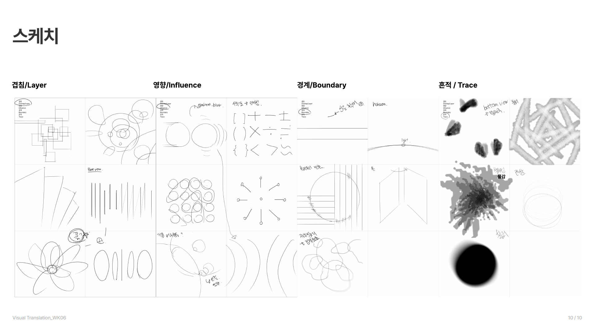
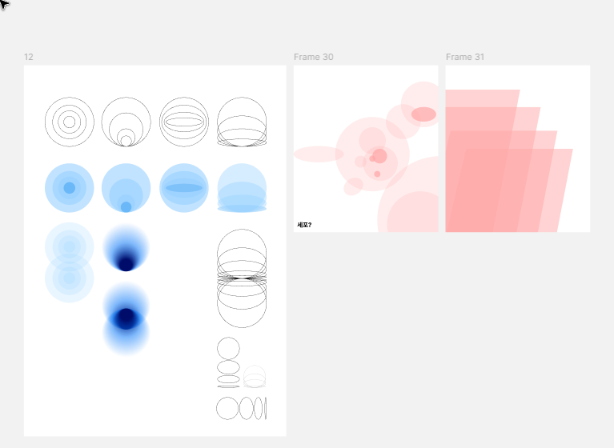

# 1021 — 전시 포스터 그래픽 1차 시안 A · B · C 마일스톤

## 과제 정보

| | |
| --- | --- |
| 과제 | 전시 포스터를 위한 그래픽 1차 시안 3종 A · B · C (Track A. Graphic Maker 개별 과제) |
| 판형 | A1 594 × 841mm (Figma 72dpi 기준 1684 × 2384px) |
| 바탕 | 팀이 함께 정한 전시 기획([POSTER.md](../POSTER.md))과 키워드 스케치(영향 · 흔적 · 경계 · 겹침) |
| 마감 | 확인 필요 |

**제출물**
1. 그래픽 1차 시안 3종 A · B · C. 시안마다 다음 세 가지를 설계한다. 요소의 비중과 관계는 시안 방향에 따라 달라도 된다
   - ① 전시 제목 디자인: 폰트 선택, 기존 서체 변형, 레터링 중에서 고른다. 글자의 형태 · 굵기 · 간격 · 리듬 · 배치가 어떤 의미와 감각을 전하는지 본다
   - ② 컬러: 색 조합과 사용 비중. 색 이름, 고른 이유, 정확한 값(RGB / CMYK / Pantone / Hex)
   - ③ 그래픽 요소: 스케치에서 찾은 점 · 선 · 면 · 형태 · 질감을 구체적인 그래픽으로 발전시킨다. 요소마다 전시의 어떤 의미를 전하는지 설명한다
2. 시안마다 디자인 의도와 의사결정 설명: **해석 및 컨셉 · 시각적 선택 · 위계/관계 · 검토**
3. 파트너와 논의한 기록
   - 파트너가 설명 없이 스케치를 읽고 의도와 해석이 맞는 지점, 어긋나는 지점을 말한다
   - 의견이 갈리면 '의미의 이해 차이'인지 '표현 선택의 차이'인지 가린다
   - 새로 보인 가능성, 지금의 고민, 다음 방향과 그 이유를 적는다
   - 기획을 고친다면 시도에서 드러난 모순 · 누락과 근거를 남긴다. 표현을 고르기 어려우면 기존 기획 안에서 다음 실험을 정한다
   - 두 사람이 이해한 전시 의도와 방향이 같은지 확인하고, 고친 서문 · 키워드와 결정 과정을 제안서에 남긴다

## 오늘 한 일
- 과제 안내를 정리했다 → [과제 정보](#과제-정보)
- 팀 발표 자료(VT_WK06_2, 10장)를 읽고, 저장소 기록과 달라진 점과 맞지 않는 점을 찾았다 → [기획 점검](#기획-점검-wk06-슬라이드)
- 지금까지 그래픽화한 구성요소를 스케치와 키워드에 연결해 정리했다 → [구성요소](#지금까지-뽑은-구성요소)
- 제출물을 기준으로 마일스톤을 잡았다 → [마일스톤](#마일스톤)

## 결과물

**키워드 스케치** (팀 · WK06 슬라이드 9쪽)

**스케치에서 뽑은 구성요소** (Figma: 12 · Frame 30 · Frame 31)

### 지금까지 뽑은 구성요소

| # | 요소 | 나온 스케치 | 키워드 | 전할 수 있는 의미 |
| --- | --- | --- | --- | --- |
| e1 | 외곽선 원 4종: 같은 중심의 동심원 / 안쪽 원이 아래로 내려앉음 / 원 안에 가로 타원 / 바닥에 쌓인 타원 | 영향(동심원 · 파동), 겹침(타원), 경계(horizon) | 영향 · 경계 | 한 세계 안에 다른 세계가 들어와 자리 잡는다. 들어온 원의 **위치**가 관계의 상태를 말한다 |
| e2 | e1을 파란 반투명 면으로 바꿈. 포개진 자리만 진해진다 | 겹침(면) | 겹침 | 겹친 넓이 = 스며든 자리. 선이 아니라 **농도**로 경계를 보인다 |
| e3 | 옅은 동심원 두 개가 위아래로 맞물림 | 영향(파동이 퍼짐) | 영향 | 두 사람이 서로에게 주는 영향이 만나는 자리 |
| e4 | 흰색 → 파랑 → 남색 방사형 그라데이션 원. 두 개가 만나면 가운데가 짙어진다 | 흔적(블러 원), 영향(gradient · blur) | 흔적 · 영향 | 테두리 없이 번진 흔적. 만난 자리에 가장 진한 것이 남는다 |
| e5 | 구를 가로로 자른 타원 단면이 한 줄(지평선)로 모였다가 다시 퍼진다 | 경계(horizon), 겹침(타원 줄) | 경계 · 겹침 | 두 세계가 맞닿는 한 줄. 겹쳐도 각자의 윤곽은 남는다 |
| e6 | 원 → 타원 → 선으로 납작해짐(정면 → 측면) | 겹침(front view), 경계 | 경계 | 보는 각도에 따라 한 세계가 선 하나로 보인다. 경계는 각자의 두께다 |
| e7 | 분홍 반투명 원 군집 (Frame 30, 메모 "세포?") | 겹침(원 군집), 영향(원 그물) | 겹침 · 영향 | 수많은 사람과 연결된 나. 슬로건의 '수많은 사람' |
| e8 | 분홍 반투명 평행사변형이 비스듬히 포개져 쌓임 (Frame 31) | 겹침(부채꼴 면) | 겹침 · 흔적 | 흔적이 한 장씩 쌓여 지금의 내가 된다. 2부 '흔적의 축적' |

- 색은 아직 실험 단계다. 원 계열은 파랑, Frame 30 · 31은 분홍을 썼다. '두 세계 = 두 색, 겹친 자리 = 제3의 색'으로 이어 볼 수 있다(M4에서 결정)
- 아직 그래픽으로 옮기지 않은 스케치: 흔적의 질감(문지른 자국, 물감 번짐, 엉킨 선), 경계의 직선(평행선, 원을 가로지르는 선), 영향의 기호(괄호 · 부호), 꽃 모양 겹침

### 기획 점검 (WK06 슬라이드)

**저장소 기록과 달라진 점** (팀이 정한 것으로 보임, 확인한 뒤 [POSTER.md](../POSTER.md)에 반영)
- 팀 이름: TEAM 04 → **TEAM 사이**
- 전시를 3부로 구성했다
  - **1부 관계 속 변화**: 우리는 누구와 함께하느냐에 따라 조금씩 다른 사람이 된다 · 니키 리
  - **2부 흔적의 축적**: 그렇게 만난 사람들의 흔적이 겹겹이 쌓여 지금의 나를 이룬다 · 카럴 마르턴스
  - **3부 서로를 설명하는 관계**: 나를 설명하는 것은 나 자신만이 아니라, 나를 기억하는 수많은 사람들이다 · 소피 칼(Sophie Calle), 《주소록》
- 키워드 순서와 머리말: **두 세계가 만나, 겹치고, 남는다** · "겹침에서 시작해 영향을 주고받고, 경계를 지닌 채 흔적을 남긴다." (겹침 → 영향 → 경계 → 흔적)
- 포스터 원고: 2026.11.05 ~ 2026.12.05 · 월–금 10:00–18:00(17:00 입장 마감), 토–일 · 공휴일 10:00–19:00(18:00 입장 마감) · 현장 구매 성인 1매 10,000원

**맞지 않는 점** (포스터에 들어갈 글이라 레이아웃 전에 정해야 한다)
1. **참여 작가**: 3부는 소피 칼인데 ③ 포스터 원고(7쪽)에는 "Karel Martens, 김애란, 니키 리"로 남아 있다
2. **메인 문장**: 1쪽 아래 문장이 이전 주제("사랑의 깊이는 … 스며든 넓이다")다. 3쪽은 1016 새 슬로건이다
3. **02 작가의 관점**: 2쪽에서 04 대상 관객과 같은 글이 들어가 있다(1016부터 남은 문제)
4. **원고에서 빠진 것**: 7쪽 원고에 협찬(Toss, Phi Institute of Design)과 QR이 없다. 휴관일도 아직 없다
5. **쪽 번호**: 02/11 · 06/10 · 04/10 · 05/10 · 07/10 · 08/10 · 10/10 · 10/10. 1부 · 2부 · 3부가 06 · 04 · 05 순서이고 총 장수가 섞여 있다

## 마일스톤

방향을 먼저 정하고(M0–M2), 시안마다 제목 · 색 · 그래픽 요소 · 위계를 만든 뒤(M3–M5), 설명과 논의를 적는다(M6–M7). 각 단계의 산출물은 다음 단계의 근거가 된다.

| # | 마일스톤 | 할 일 | 산출물 | 완료 기준 | 상태 |
| --- | --- | --- | --- | --- | --- |
| M0 | 기획 기준 고정 | 위 '맞지 않는 점' 1–4를 팀과 정한다. 포스터에 들어갈 글 목록을 확정한다 | 확정 원고 목록 · POSTER.md 갱신 | 포스터 원고 · 참여 작가 · 메인 문장이 모든 자료에서 같다 | 대기 (팀 확인) |
| M1 | 구성요소 추출 | 스케치 → 그래픽 요소. 요소마다 나온 스케치 · 키워드 · 의미를 단다. 형태 말고 색 · 질감 · 간격 · 밀도 · 크기 축으로도 뽑는다 | 위 구성요소 표(e1–e8 + 추가) | 남은 스케치(질감 · 직선 · 기호)까지 훑었고, 요소마다 기획의 한 문장을 댈 수 있다 | **진행 중** |
| M2 | 시안 방향 A · B · C | 시안마다 출발 키워드, 포스터의 **핵심 순간** 한 문장, 제목 방식을 정한다. 세 시안이 색만 다른 변주가 되지 않도록 출발 키워드 · 제목 방식 · 위계를 서로 다르게 둔다 | 방향 표 (아래 초안) | 세 문장이 서로 다른 순간을 말하고, 각각 기획 문장과 이어진다 | 초안 |
| M3 | 제목 디자인 | 시안마다 한국어 · 영문 제목을 만든다. 형태 · 굵기 · 간격 · 리듬 · 배치가 무엇을 뜻하는지 한 줄씩 적는다 | 제목 3종 (A1 크기에서 확인) | 제목만 봐도 그 시안의 키워드가 읽힌다 | 대기 |
| M4 | 컬러 | 시안마다 2–4색 조합과 비중(%)을 정한다. 색 이름 · 이유 · RGB / CMYK / Pantone / Hex를 적는다 | 컬러 표 3개 | 값 네 가지가 다 있고, 색마다 기획과 이어지는 이유가 있다 | 대기 |
| M5 | 그래픽 요소 · 위계 · 레이아웃 | M1 요소를 시안 방향에 맞게 발전시키고 A1 판형에 원고와 함께 앉힌다. 정보 위계: 제목 → 핵심 그래픽 → 기간 → 슬로건 · 질문 → 참여 작가 → 장소 · 미술관 → 시간 · 티켓 · 협찬 · QR (시안마다 조정) | A1 시안 3장 (PNG · PDF) | 축소본(A4 · 약 35%)에서 위계가 읽히고, 실제 크기에서 작은 글자가 읽힌다 | 대기 |
| M6 | 디자인 의도 설명 | 시안마다 해석 및 컨셉 · 시각적 선택 · 위계/관계 · 검토 네 항목을 팀이 이해한 말로 쓴다 | 설명 3세트 | 주요 선택 하나하나를 기획 의도와 연결해 말할 수 있다 (LO3) | 대기 |
| M7 | 파트너 논의 · 기록 | 설명 없이 스케치와 시안을 보여 주고 해석을 듣는다. 맞는 지점과 어긋나는 지점, 그 차이가 이해 차이인지 표현 차이인지 기록한다. 기획을 고치면 근거를 남긴다 | 논의 기록 (아래 양식) | 두 사람이 이해한 의도와 방향이 같은지 확인했다 | 대기 |
| M8 | 제출 정리 | WK06 슬라이드 '그래픽' 장(10쪽) 채우기, 시안 · 설명 · 논의 기록을 제안서에 넣는다. POSTER.md · README.md 반영 | 제출 PDF | 제출물 1–3이 모두 들어 있다 | 대기 |

- M0은 M5 전에만 끝나면 된다. M1–M4와 나란히 진행한다
- M7은 끝에 한 번만 하지 않는다. M2(방향) 뒤에 스케치로 한 번, M5(시안) 뒤에 한 번 더 한다
- 멈출 때(LO4): 시안마다 요소 하나를 빼 봤을 때 무엇이 사라지는지 말할 수 있으면 1차 시안을 멈춘다

### M2 시안 방향 초안

출발 키워드 · 제목 방식 · 위계를 시안마다 다르게 둔다. 과제가 든 제목 방식 세 가지(폰트 선택 · 서체 변형 · 레터링)를 하나씩 맡긴다.

| | A | B | C |
| --- | --- | --- | --- |
| 출발 키워드 | **겹침** | **영향** | **흔적 · 경계** |
| 핵심 순간 (초안) | 따로 있던 두 면이 포개지고, 겹친 자리에만 새 색이 생기는 순간 | 한 사람의 색이 다른 사람 쪽으로 번져 가운데가 짙어지는 순간 | 함께했던 것이 떠난 뒤, 윤곽과 자국만 남은 순간 |
| 이어지는 기획 문장 | "서로의 세계가 겹치고 스며드는 과정" · 2부 흔적의 축적 | "서로의 말과 생각, 행동에 영향을 주고받으며 변화한다" · 1부 관계 속 변화 | "관계가 끝난 뒤에도 쉽게 사라지지 않는다" · "각자의 고유함을 간직한 채" · 3부 |
| 쓸 요소 | e2 · e7 · e8 (반투명 면, 오버프린트) | e3 · e4 (동심원, 방사형 그라데이션) | e1 · e5 · e6 (외곽선, 타원 단면) + 흔적 질감 |
| 제목 방식 | **폰트 선택**: 기존 서체를 그대로 쓰되 글자끼리 겹치게 자간을 좁히고, 겹친 획만 진하게 | **서체 변형**: 획 가장자리가 다음 글자 쪽으로 번진다 | **레터링**: 획 일부가 지워지고 외곽선만 남는다 |
| 위계 | 그래픽과 제목이 한 덩어리 | 그래픽이 화면을 차지하고 제목은 작고 단단하게 | 제목(타이포)이 주인공, 그래픽은 가는 선 |
| 색 방향 | 두 색 + 겹친 제3의 색 | 한 색의 농도 단계 (흰 → 파랑 → 남색) | 거의 흑백 + 흔적 한 색 |

- 세 방향이 모두 '두 원이 겹친다'로 수렴하지 않는지 M2 논의에서 확인한다. 1015 피드백("키워드가 명사로 멈춰 있지 않은가", "포스터는 한순간이다")을 기준으로 본다

### M4 컬러 표 양식

| 색 이름 | 역할 · 비중 | 고른 이유 (기획과의 연결) | Hex | RGB | CMYK | Pantone |
| --- | --- | --- | --- | --- | --- | --- |
| | | | | | | |

- CMYK는 인쇄 프로파일(예: Japan Color 2001 Coated)로 변환한 값을 적는다. Pantone은 Pantone Connect나 Figma 플러그인에서 가장 가까운 칩을 찾고, 화면 값과 차이가 크면 적어 둔다

### M7 파트너 논의 기록 양식

| 항목 | 내용 |
| --- | --- |
| 파트너 · 일시 | |
| 보여 준 것 | 스케치 / 시안 A · B · C (설명 없이) |
| 파트너가 읽은 것 | |
| 의도와 맞는 지점 | |
| 어긋나는 지점 | |
| 차이의 종류 | 의미의 이해 차이 / 표현 선택의 차이 |
| 새로 보인 가능성 | |
| 지금 고민되는 지점 | |
| 다음 방향과 이유 | |
| 기획 수정 (모순 · 누락 · 근거) | |
| 두 사람의 의도가 같은가 | |

## 피드백 / 고민
- LO1(해석): 구성요소는 모였지만 아직 '어느 순간을 보여 주는가'가 정해지지 않았다. M2에서 시안마다 핵심 순간 한 문장을 먼저 쓰고 요소를 고른다
- LO2(번역): 지금 요소는 대부분 원(형태)이다. 1015에서 짚은 대로 색 · 질감 · 밀도로 그린 스케치(문지른 자국, 번짐, 엉킨 선)를 M1에서 더 옮겨야 세 시안이 갈라진다
- LO3(일관성): 3부 구성이 생겼으니 포스터 한 장이 세 부를 모두 담을지, 하나의 순간으로 묶을지 정해야 한다. 초안은 시안마다 한 부에 기대도록 짰다
- 파랑과 분홍을 각각 쓴 이유가 아직 없다. 두 세계를 두 색으로 둘지, 한 색의 농도로 둘지가 A와 B를 가르는 선택이 된다

## 글로벌 파일에 반영할 것
- [ ] [POSTER.md](../POSTER.md): 팀 이름 · 3부 구성 · 참여 작가(소피 칼) · 키워드 머리말 · 포스터 원고(연도, 관람 시간, 티켓) — M0에서 팀 확인 뒤
- [x] [README.md](../README.md) 날짜별 기록에 1021 추가

## 다음 할 일
- [ ] M0: 참여 작가(김애란 / 소피 칼), 1쪽 메인 문장, 02 작가의 관점, 협찬 · QR · 휴관일을 팀에 확인
- [ ] M1: 남은 스케치(질감 · 직선 · 기호)에서 요소 더 뽑기
- [ ] M2: 핵심 순간 세 문장 확정, 파트너에게 스케치로 첫 논의
- [ ] 마감일 확인
