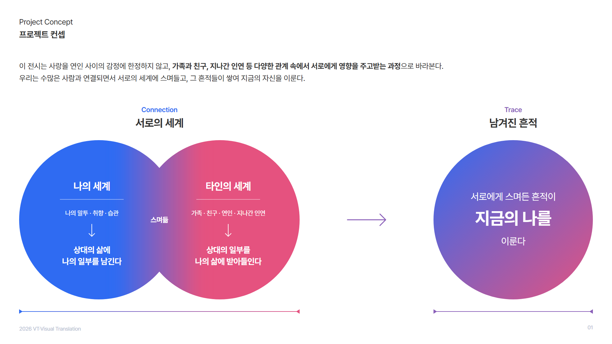
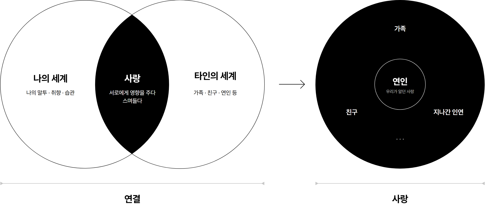
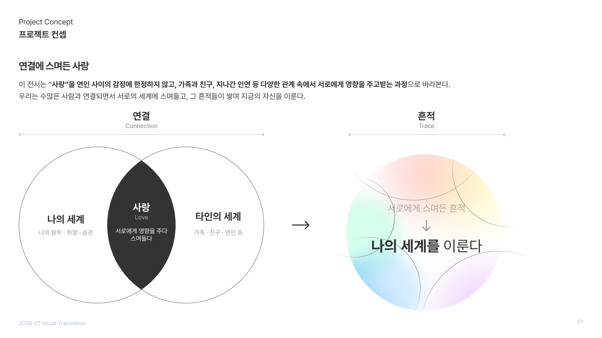
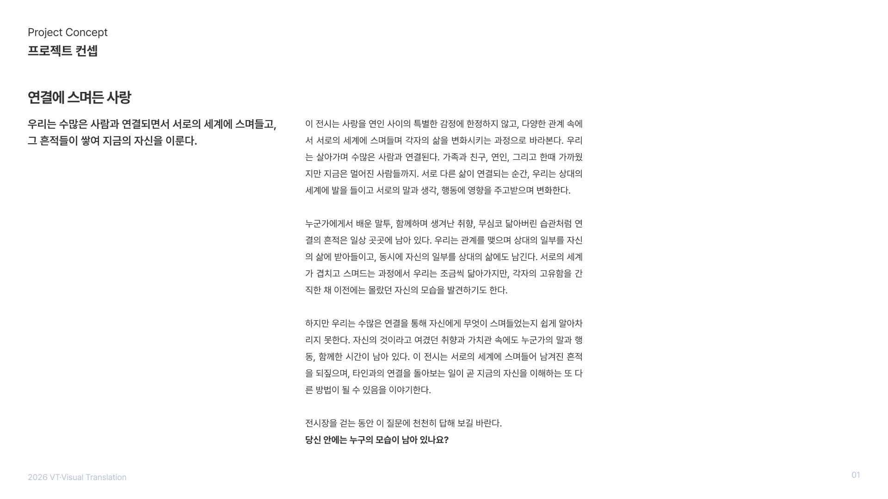
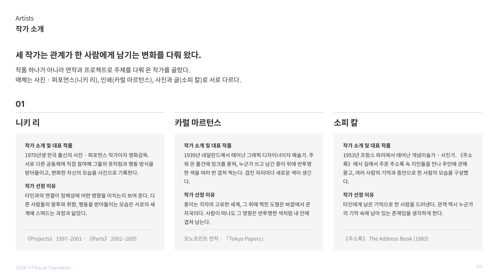
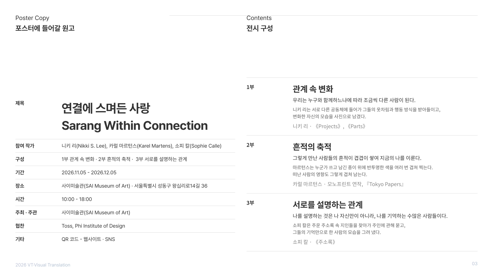

# 1022 — 지금까지의 핵심 정리

## 오늘 한 일
- 1007~1015의 날짜 기록과 글로벌 파일([CONCEPT.md](../CONCEPT.md) · [POSTER.md](../POSTER.md) · [INSIGHTS.md](../INSIGHTS.md))을 다시 읽고 핵심만 추렸다
- 흩어져 있던 미결 사항과 다음 할 일을 한곳에 모았다 → [다음 할 일](#다음-할-일)
- 발표 PPT ① 프로젝트 컨셉 장이 글자가 많아 핵심이 전달되지 않는다 → 하단에 들어갈 도식을 그렸다 → [도식](#도식-프로젝트-컨셉-장-하단)

## 도식: 프로젝트 컨셉 장 하단

- 구성은 '교육 대상 → 교육 목적' 레퍼런스(두 원 + 화살표 + 결과 원 + 아래 범위선)를 따랐다
- **Connection 서로의 세계**: 나의 세계(말투 · 취향 · 습관 → 상대의 삶에 나의 일부를 남긴다)와 타인의 세계(가족 · 친구 · 연인 · 지나간 인연 → 상대의 일부를 나의 삶에 받아들인다). 맞닿은 자리가 **스며듦**
- **Trace 남겨진 흔적**: 서로에게 스며든 흔적이 **지금의 나를** 이룬다
- 조형 선택과 기획의 연결 (LO3)
  - 두 원의 바깥 윤곽은 선명하게 둔다 → 서문의 "각자의 고유함을 간직한 채" (키워드 **경계**)
  - 겹친 자리에는 선을 긋지 않고 파랑과 분홍이 번지며 보라가 된다 → "어느 한쪽의 것도 아닌 새로운 색", '벤다이어그램처럼 딱 나뉘지 않는다'는 주제의식 2 (키워드 **겹침 · 영향**)
  - 결과 원은 두 색이 섞인 그라데이션이다 → 지금의 나 안에 타인의 색이 남아 있다 (키워드 **흔적**)
- 파일: [diagram.svg](diagram/diagram.svg)(도식만, 1800×680, 슬라이드의 x 60 · y 320에 1:1로 놓는다) · [diagram@2x.png](diagram/diagram@2x.png)(투명 배경 3600×1360) · [slide_01.png](diagram/slide_01.png)(미리보기) · 원본 [build.js](diagram/build.js)(`node build.js`로 다시 만든다)
- 남은 고민: 팀 덱은 흑백인데 도식에만 색이 들어간다. 다른 장에도 이 두 색(나 = 파랑, 타인 = 분홍, 섞임 = 보라)을 규칙으로 쓸지 팀과 정해야 한다 (LO3)

### v2: 팀 흑백 정리안 + 더 큰 사랑

- 왼쪽은 팀이 흑백으로 정리한 벤 도식이다: 나의 세계 · **사랑**(겹친 자리, 검정) · 타인의 세계, 아래 범위선 **연결**
- 오른쪽을 더했다: 겹친 자리의 검정(사랑)이 화살표를 지나 **큰 검은 원**이 된다. 우리가 흔히 '사랑'이라 부르는 **연인**은 그 안의 작은 원 하나이고, 가족 · 친구 · 지나간 인연이 같은 원 안에 놓인다. 아래 범위선은 **사랑**
- 범위선 두 개를 읽으면 '연결 → 사랑', 곧 제목 「연결에 스며든 사랑」이 된다
- 파일: [v2_right.svg](diagram/v2_right.svg)(오른쪽만, 팀 이미지와 같은 단위) · [v2_full.png](diagram/v2_full.png)(미리보기) · 원본 [build_v2.js](diagram/build_v2.js)
- 짚을 점 (LO3): 왼쪽 겹침이 선명한 윤곽의 벤다이어그램이라, 주제의식 2('벤다이어그램처럼 딱 나뉘지 않고 스며든다')와 부딪힌다. 렌즈 가장자리만 흐리게 할지 팀과 정한다
- 영어 제목: 'Love'가 연인 사이의 사랑으로 좁게 읽히는 문제 → `OOO Within Connection` 틀을 유지하고 앞 단어를 찾는 중. 후보 Affection(사랑의 넓은 뜻) · Warmth(시각 번역이 쉬움) · Loves(복수형). 정하면 POSTER.md에 반영한다

## 팀 덱 개편 (Figma)

| 01 프로젝트 컨셉 | 02 서문 | 03 작가 소개 |
| --- | --- | --- |
|  |  |  |

- **01 프로젝트 컨셉**(팀 작업): 두 문장 + 도식. 연결(나의 세계 · 사랑 Love · 타인의 세계) → 흔적(서로에게 스며든 흔적 → 나의 세계를 이룬다). 흔적 원은 여러 원이 번지는 파스텔 그라데이션
- **02 서문**(팀 작업): 머리 문장을 '스며든 넓이'에서 "우리는 수많은 사람과 연결되면서 서로의 세계에 스며들고, 그 흔적들이 쌓여 지금의 자신을 이룬다"로 바꿨다 → [POSTER.md ②](../POSTER.md)
- **03 작가 소개**(Figma에 새로 만듦): 참여 작가 목록 레퍼런스(이름 머리줄 + 항목 카드 + 대표 작업 꼬리줄)를 덱의 흰 테마로 옮겼다
  - 거쳐 온 안: 겹침(마르턴스) → 영향(니키 리) → 흔적(김애란) 초안 → 팀 덱의 1 · 2 · 3부(니키 리 · 카럴 마르턴스 · 소피 칼)로 '작가 소개 · 전시 구성' → 전시 구성을 빼고 **작가 소개만** 남김. 구성은 팀 작가 장(1 · 2 · 3부)이 맡는다
  - 지금 구성: 머리말 Artists / 작가 소개, 한 줄 "세 작가는 관계가 한 사람에게 남기는 변화를 다뤄 왔다." + 선정 기준과 매체, 세 단(니키 리 · 카럴 마르턴스 · 소피 칼). 카드 항목은 팀 작가 장과 같은 **작가 소개 및 대표 작품 · 작가 선정 이유**, 꼬리줄은 대표 작업
  - 단은 컴포넌트 `Artist Column` 하나로 만들고 인스턴스로 반복했다. 텍스트는 컴포넌트 속성(작가 · 번호 · 작가 소개 및 대표 작품 · 작가 선정 이유 · 대표 작업)으로 바꾼다
  - 직접 넣었던 전시 구성 문장과 머리말(전시 구성 / Exhibition Structure)은 지우지 않고 숨겼다
  - 팀의 작가 장(작가 사진 포함)은 저작권 자료라 저장소에 올리지 않았다
- **04 포스터에 들어갈 원고**(Figma 프레임 "4"에 새로 만듦): 레퍼런스(Poster Copy) 형식만 따랐다. 머리말 + 오른쪽 설명줄, 제목 · 문구 두 단, 전시 정보 표
  - 제목: 연결에 스며든 사랑 / Sarang Within Connection · 문구: 당신 안에는 누구의 모습이 남아 있나요?
  - 전시 정보 7줄: 참여 작가 · 기간 · 장소 · 시간 · 주최 · 주관 · 협찬 · 기타. 줄은 컴포넌트 `Info Row`(항목 · 내용 속성)로 반복했다
  - 내용은 [POSTER.md ③](../POSTER.md) 원고. 참여 작가는 팀 덱 기준(니키 리 · 카럴 마르턴스 · 소피 칼), 연도는 2026으로 채웠다. 휴관일은 아직 정하지 않아 넣지 않았다
  - 팀이 장을 둘로 나눴다: 왼쪽 Poster Copy(제목 + 전시 정보), 오른쪽 **Contents / 전시 구성**. 오른쪽 회색 자리에 1 · 2 · 3부를 넣었다(회색 박스는 숨김)
  - 전시 구성: 세 칸을 같은 높이로 쌓고, 왼쪽 표와 같은 규칙(가는 선, 180px 항목 열)을 썼다. 칸마다 부 · 부 제목 · 한 줄 · 작가와 대표 작업. 컴포넌트 `Exhibition Part`(부 · 부 제목 · 한 줄 · 작가 속성)
    - 1부 관계 속 변화 · 니키 리 / 2부 흔적의 축적 · 카럴 마르턴스 / 3부 서로를 설명하는 관계 · 소피 칼
    - 한 줄과 작가 줄 사이 여백에 **상세 설명**(18px, 두 줄)을 더했다: 그 부에서 작가가 무엇을 하는지. Figma는 한글을 글자 단위로 줄바꿈하므로 단어 경계에 직접 줄을 나눴다
      - 1부: 니키 리는 서로 다른 공동체에 들어가 그들의 옷차림과 행동 방식을 받아들이고, 변화한 자신의 모습을 사진으로 남겼다.
      - 2부: 마르턴스는 누군가 쓰고 남긴 종이 위에 반투명한 색을 여러 번 겹쳐 찍는다. 떠난 사람의 영향도 그렇게 겹쳐 남는다.
      - 3부: 소피 칼은 주운 주소록 속 지인들을 찾아가 주인에 관해 묻고, 그들의 기억만으로 한 사람의 모습을 그려 냈다.
  - 
- 마지막에 한 번에 손볼 것: Figma에 새로 넣은 텍스트(03 작가 소개, 04 포스터 원고)의 글꼴을 Pretendard로 교체

## 한눈에 보기

| 날짜 | 과제 | 핵심 |
| --- | --- | --- |
| [1007](../1007/) | 앨범 | 방향 전환(고상함 → 캐주얼·재치), **사진은 덥게, 그래픽은 시원하게**, 1차 촬영 10컷 |
| [1008](../1008/) | 공통 | 마틴 파 전시: 형식이 곧 태도, 대상과의 거리감이 곧 애정도 |
| [1009](../1009/) | 앨범 | 날씨 UI 시안 3종(카드 · 곡선 · 열화상), 외곽선 스크립트 타이틀 |
| [1011](../1011/) | 앨범 | 앨범 소개를 '같은 숫자, 다른 감각'으로 수정, 트랙리스트 교체 |
| [1013](../1013/) | 포스터 | 주제의식 확정(**스며든 넓이**), 제출 슬라이드 ①~⑤, 참여 작가 3인 |
| [1015](../1015/) | 공통 | 서정민 강의 + 마이클 록: **디자이너는 번역가다**, 키워드는 명사가 아니라 순간이다 |

---

## 1. 지난 과제: 앨범 「21°C」 → [CONCEPT.md](../CONCEPT.md)

- **한 문장**: 같은 21도도 어디에서 왔느냐에 따라 전혀 다른 감각이 된다
- **표현 전략**: 사진은 덥게(바깥), 그래픽은 시원하게(안). 한 장에 대비와 전환을 함께 담는다
- **시안**: v01 카드(위·아래, `Door`에서 34°→23°) · v02 곡선(띠) · v03 열화상(재질). '전환'이 가장 직접 보이는 건 v01
- **남은 것**: 키워드 5개 → 3개(대비 · 전환 · 공기) 정리, 치토스 로고 처리, 트랙리스트를 바꾼 이유. 커버 최종안은 아직 저장소에 기록되지 않았다

## 2. 현재 과제: 전시 포스터 「연결에 스며든 사랑」 → [POSTER.md](../POSTER.md)

TEAM 04: 이가은 · 임창균 · 조용주(그래픽 메이커)

> **사랑의 깊이는 좋아하는 마음의 크기가 아니라, 서로의 세계가 스며든 넓이다.**
> 관객에게 건네는 질문: "당신 안에는 누구의 모습이 남아 있나요?"

- **제목 해석**: 연결 = 각자의 세계를 서로에게 여는 일 / 스며든 = 선으로 나뉘는 교집합이 아니라 번지며 경계가 흐려지는 방식 / 사랑 = 그렇게 스며든 넓이
- **전하고 싶은 감각**: 익숙한 나의 모습에서 문득 누군가를 발견하는 순간의 낯설고도 따뜻한 느낌
- **어떻게 여기까지 왔나**: 7개 안 → '세계의 교집합' → 공식(교집합의 크기 = 관계의 깊이) → '겹친 넓이'와 '나뉘지 않음'이 부딪혀 **스며든 넓이**로 합쳐짐
- **시각화 키워드**: **영향 · 흔적 · 경계 · 겹침** (사랑 · 연결은 너무 추상적이라 뺐다)

| 키워드 | 시각화 방향 |
| --- | --- |
| 영향 | 한쪽 형태가 다른 쪽에 의해 휘거나 변형됨, 주변으로 번지는 색 |
| 흔적 | 얼룩, 지문, 찍힌 자국, 지워졌지만 남은 선 |
| 경계 | 선명한 윤곽과 흐려진 부분의 대비, 섞였지만 사라지지 않은 상태 |
| 겹침 | 반투명 도형의 포개짐, 겹친 부분만 진해지는 오버프린트 |

- **참여 작가**: 카럴 마르턴스(타인의 흔적 위에 색을 겹친다) · 김애란 『잊기 좋은 이름』(나를 지나온 이름들) · 니키 리(다른 공동체에 스며들며 바뀌는 나)
- **포스터 원고**: 사이미술관(SAI Museum of Art, 두 세계 '사이'의 공간) · 11/05~12/05 · 성수동 · 10:00-18:00 · 협찬 Toss, Phi
- **산출물**: 제출 슬라이드 [1013/slides](../1013/slides/) · 발표 덱 압축판 6장 [WK05/deck](../WK05/deck/) · 전체판 10장 [WK05/deck-full](../WK05/deck-full/) · [웹페이지(임시)](https://yongzu.github.io/VT/WK05/)

## 3. 지금까지 배운 것 → [INSIGHTS.md](../INSIGHTS.md)

1. **디자이너는 번역가다.** 원문(기획)은 주어지지만 무엇을 핵심으로 읽고 어떤 형식으로 옮길지는 내가 정한다. 같은 조건에서 100명이면 100개가 나와야 하고, 모두 목표에 닿아야 한다 ([1015](../1015/))
2. **키워드는 명사가 아니라 순간이다.** '눈'이 아니라 '눈을 뜨는 순간(개안)'. 무슨 이야기를 할지 먼저 정하면 핵심 단어가 나온다 ([1015](../1015/))
3. **포스터는 한순간이다.** 설명적 내러티브 대신, 앞뒤 관계가 읽히는 정지된 한 장 ([1015](../1015/))
4. **레퍼런스에서 출발하면 낙하산을 탄 것이다.** 과정을 건너뛰면 관점이 쌓이지 않고 작업이 동떨어진 섬이 된다 ([1015](../1015/))
5. **형식이 곧 태도다.** 컬러 · 플래시 · 거리 같은 형식 선택이 시선과 애정도를 드러낸다 ([1008](../1008/))
6. **스케치는 형태만이 아니다.** 색 · 질감 · 간격 · 밀도 · 크기 · 재료로, 해석 자체를 바꿔 가며 그린다 ([1015](../1015/))
7. **기획 글은 수사보다 평서문.** 콘셉트는 평가자에게 쓰는 설계도, 서문은 관람객에게 쓰는 안내다 ([1013](../1013/))

## 피드백 / 고민 — 루브릭 기준으로 본 현재 위치 (포스터)

| LO | 지금 상태 | 다음 점검 |
| --- | --- | --- |
| **LO1 해석** | 한 문장 요약과 질문은 섰다. 키워드도 '시각화할 수 있는가'로 걸렀다 | 키워드 넷이 아직 **명사**다. 이 전시만의 **순간**을 말하는가? (예: 겹침 → 겹치기 시작하는 순간, 흔적 → 떠난 뒤에 남은 것) |
| **LO2 번역** | 1013 교집합 스케치와 1015 키워드 스케치가 있다 | 스케치가 형태(점·선·면) 위주였다. 질감 · 재료(번지는 종이, 물, 반투명)로 '스며듦'을 다시 그린다. 레퍼런스 없이 |
| **LO3 일관성** | 제목 해석 → 주제의식 → 키워드 → 작가가 같은 축(스며든 넓이)으로 이어진다 | 벤다이어그램은 우리가 스스로 버린 '딱 나뉘는 교집합'이다. 시안이 다시 그쪽으로 가지 않는지 본다 |
| **LO4 완성도** | 아직 시안 전 단계 | 포스터 한 장의 **핵심 순간**(따로 → 스며듦의 앞뒤)을 먼저 정해야 요소를 빼고 더할 기준이 생긴다 |

- 앨범에서 쓴 '바깥 / 안'처럼, 포스터도 **앞(각자의 세계)과 뒤(스며든 넓이)** 를 한 장에 담는 구조가 필요하다. 1015에서 정민님이 말한 "앞뒤 관계가 있어야 순간이 보인다"와 같은 이야기다

## 글로벌 파일에 반영할 것
- [x] 새로 올릴 내용 없음 (이미 글로벌 파일에 반영된 내용을 요약했다)
- [ ] 키워드를 '순간'으로 다시 쓰면 → POSTER.md ④

## 다음 할 일

**포스터 (현재)**
- [ ] 포스터의 핵심 순간 후보를 한 문장씩 3개 쓰기 ([1015](../1015/))
- [ ] 키워드 4개를 '순간 · 상태 변화'로 다시 써 보고 팀과 공유 ([1015](../1015/))
- [ ] 키워드별 스케치를 형태 외 요소(색 · 질감 · 간격 · 밀도 · 크기 · 재료)로 추가 ([1013](../1013/) · [1015](../1015/))
- [ ] 서문의 참여 작가 문단 쓰기: 세 작가가 왜 한 전시에서 만나는가 ([POSTER.md](../POSTER.md#아직-결정하지-못한-쟁점))
- [ ] 정하지 못한 쟁점: 드로잉 매체를 어떻게 담을지, 부정(−) 요소를 그래픽에서 다룰지
- [ ] 포스터 원고 보완: 휴관일, 연도, QR 연결 웹사이트, 무빙 포스터 여부
- [ ] 슬라이드 오타 · 메모 정리 ([1013](../1013/#피드백--고민))
- [ ] 웹페이지 스타일 정하기 (지금은 IPS 5주차 스타일을 임시로 씀)

**앨범 (지난 과제, 기록 마무리)**
- [ ] 트랙리스트를 바꾼 이유를 논의 기록에 적기 ([1011](../1011/))
- [ ] 키워드 3개, 치토스 로고 처리, 최종안을 CONCEPT.md에 남기기
