# 1030 — 시각화 다듬기: WK07 팀 덱 · 포스터 초안 7종

## 오늘 한 일
- WK07 팀 덱(8장)을 정리했다. 팀 이름을 **Team SAI (사이)** 로 정하고, 키워드 · 스케치 · 그래픽 장을 새로 넣었다 → [팀 덱](#wk07-팀-덱)
- 그래픽 콘셉트를 정했다: **반투명한 원이 겹칠수록 밝아지고, 겹침이 쌓여 하나의 꽃이 된다** → [그래픽](#그래픽-겹침이-쌓여-꽃이-된다)
- 포스터 초안 7종을 만들었다. 그래픽(꽃) 3종, 이미지(물속 잉크) 3종, 하트 잎 1종 → [포스터 초안](#포스터-초안-7종)
- 원본: 로컬 `Desktop\Phi\03_VT_Visual-Translation\WK08\` (`WK07.pdf`, `포스터 초안.pdf`). 저장소에는 webp로 옮겼다

## WK07 팀 덱

| 00 표지 | 01 프로젝트 컨셉 | 02 서문 | 03 작가 소개 |
| --- | --- | --- | --- |
| 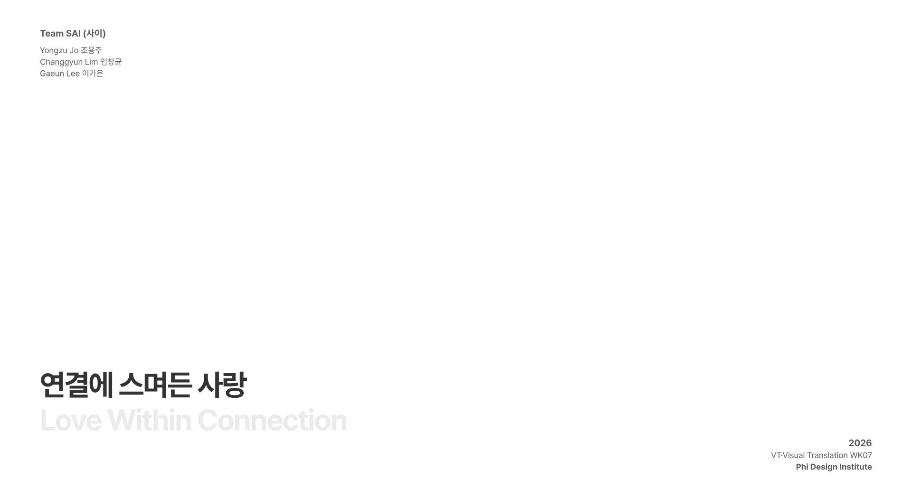 | 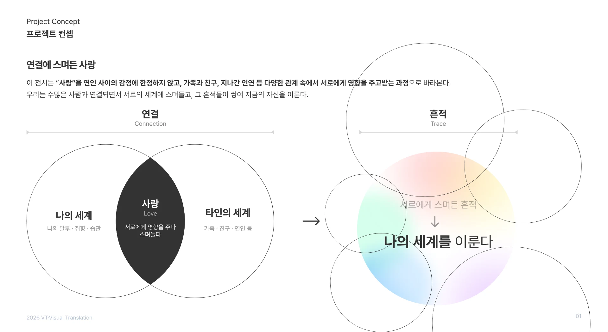 | 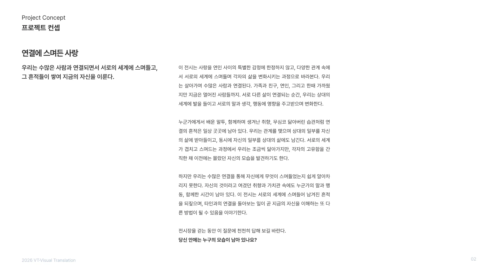 | 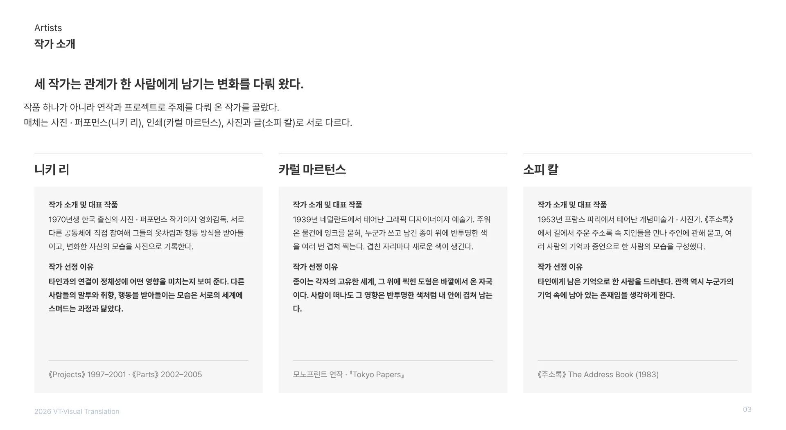 |
| **04 원고 · 전시 구성** | **05 키워드** | **06 스케치** | **07 그래픽** |
| 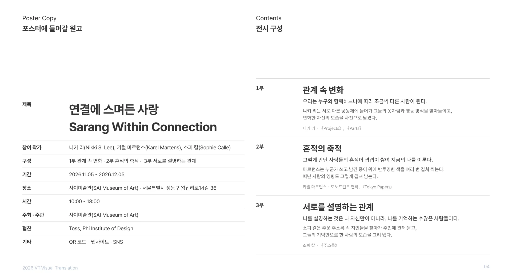 | 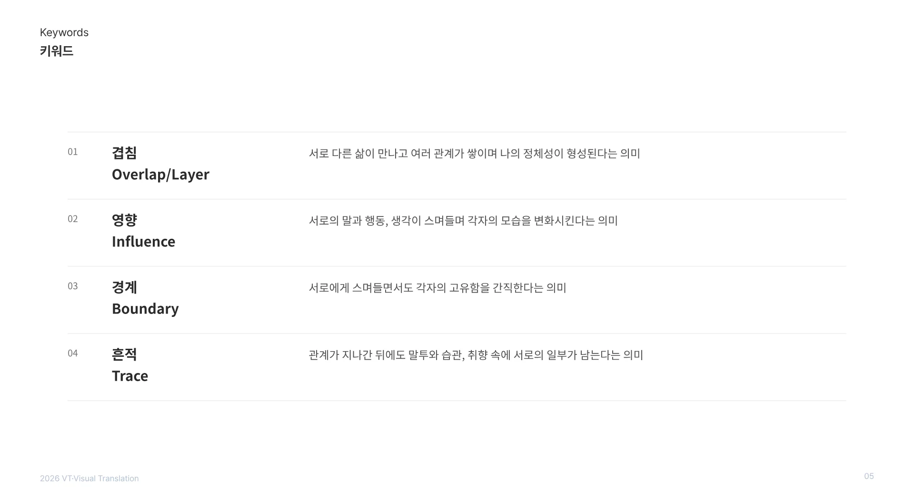 | 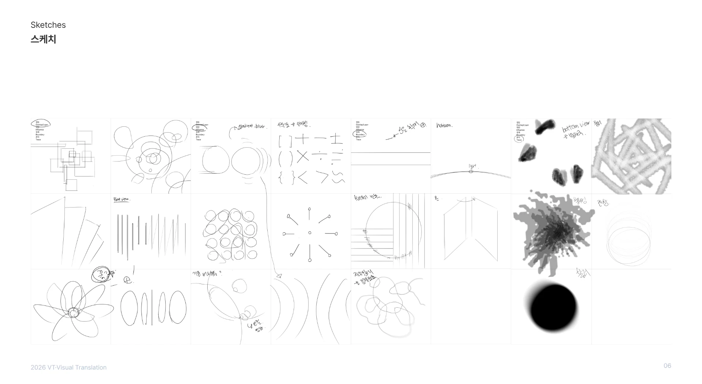 | 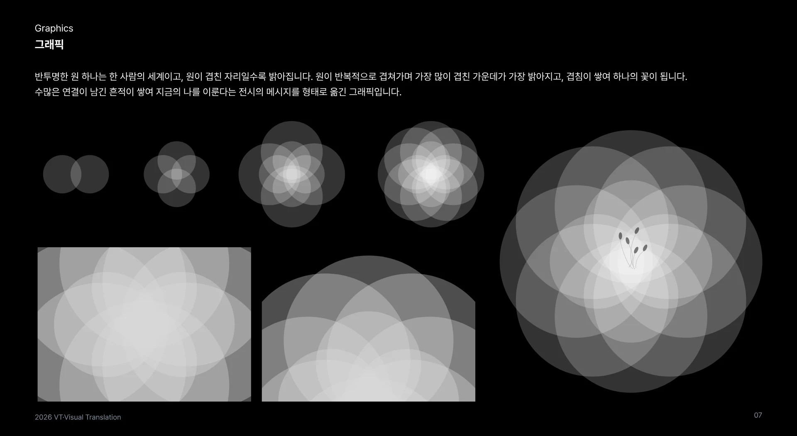 |

- **00 표지**: Team SAI (사이) · 조용주 · 임창균 · 이가은. 미술관 이름(사이미술관)과 같은 '사이'를 팀 이름으로 썼다
- **01 · 02**: 1022 팀 덱 그대로. 컨셉 도식(연결 → 흔적)과 1016 서문
- **03 작가 소개**: 머리 문장 "세 작가는 관계가 한 사람에게 남기는 변화를 다뤄 왔다." 매체가 사진 · 퍼포먼스(니키 리), 인쇄(카럴 마르턴스), 사진과 글(소피 칼)로 서로 다르다는 점을 함께 적었다
- **04 원고 · 전시 구성**: 원고 표에 **구성**(1부 관계 속 변화 · 2부 흔적의 축적 · 3부 서로를 설명하는 관계)을 넣고, 장소를 '사이미술관 · 서울특별시 성동구 왕십리로14길 36'으로 합쳤다
- **05 키워드**: 순서를 **겹침 → 영향 → 경계 → 흔적**으로 바꾸고 뜻을 한 줄로 줄였다
  - 겹침 Overlap/Layer: 서로 다른 삶이 만나고 여러 관계가 쌓이며 나의 정체성이 형성된다
  - 영향 Influence: 서로의 말과 행동, 생각이 스며들며 각자의 모습을 변화시킨다
  - 경계 Boundary: 서로에게 스며들면서도 각자의 고유함을 간직한다
  - 흔적 Trace: 관계가 지나간 뒤에도 말투와 습관, 취향 속에 서로의 일부가 남는다
- **06 스케치**: 키워드별 손 스케치 24칸. 겹친 사각형 · 원, 블러(gradient blur), 수평선과 빛(horizon, light), 번지는 얼룩, 바닥에서 본 시점(bottom view), 꽃 모양 겹침, 가장자리가 흐린 검은 원 등

## 그래픽: 겹침이 쌓여 꽃이 된다

> 반투명한 원 하나는 한 사람의 세계이고, 원이 겹친 자리일수록 밝아진다. 원이 반복적으로 겹쳐 가며 가장 많이 겹친 가운데가 가장 밝아지고, 겹침이 쌓여 하나의 꽃이 된다. 수많은 연결이 남긴 흔적이 쌓여 지금의 나를 이룬다는 전시의 메시지를 형태로 옮긴 그래픽이다. (팀 덱 07)

- 원 2개 → 4개 → 8개 → 꽃으로 늘어나는 과정을 보여 준다. 마지막 꽃 가운데에는 수술을 그려 넣었다
- 1022 도식의 '두 원 → 겹친 자리(사랑) → 흔적'을 그대로 이어받았다. 도식이 그래픽으로 발전한 것이다 (LO2)
- 키워드와의 연결 (LO3)
  - **겹침**: 반투명한 원이 포개진다
  - **흔적**: 겹친 횟수만큼 밝기가 쌓인다. 가장 많이 겹친 가운데가 '지금의 나'
  - **경계**: 원 하나하나의 윤곽이 끝까지 남는다. 섞여도 각자의 원은 사라지지 않는다
  - **영향**: 아직 형태로 드러나지 않는다. 포스터에서 블러와 그레인으로 번짐을 더했다

## 포스터 초안 7종

| 01 꽃 | 02 나뉜 원 | 03 꽃 + 붓 제목 | 04 잉크 A |
| --- | --- | --- | --- |
| 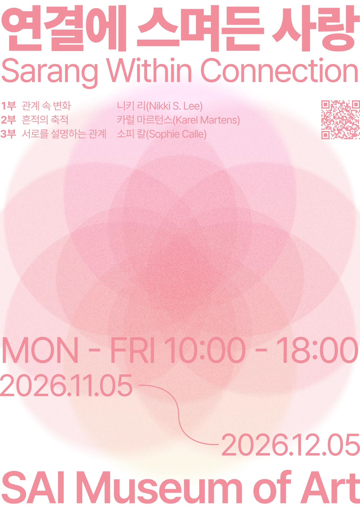 | 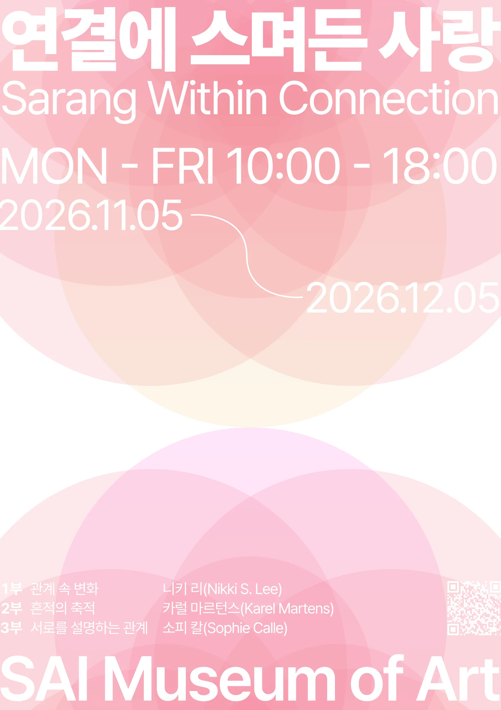 | 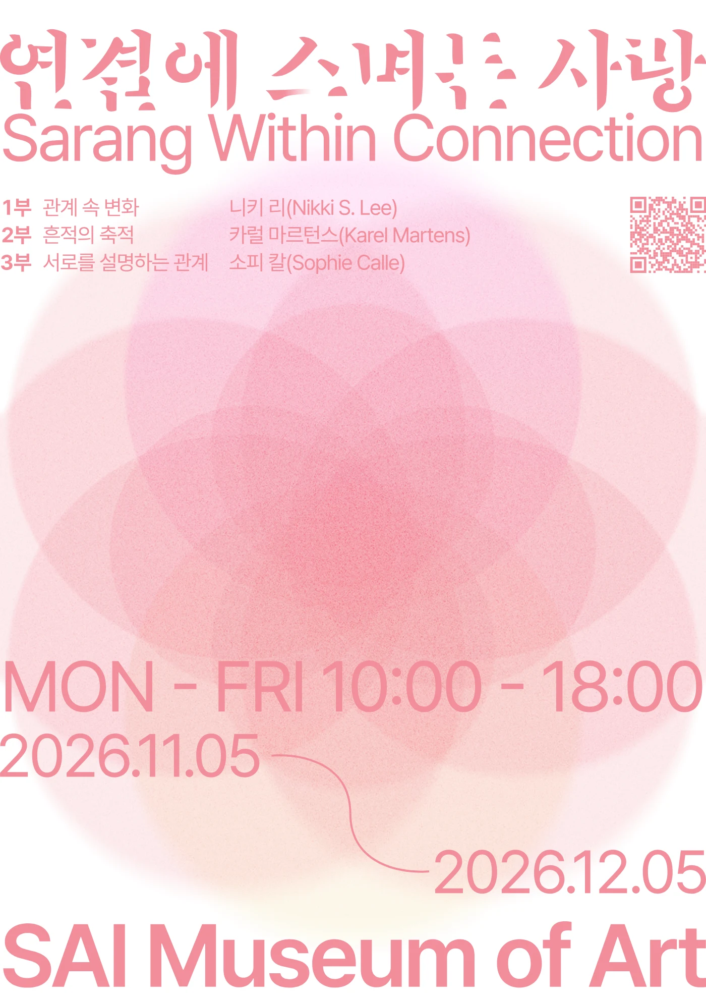 | 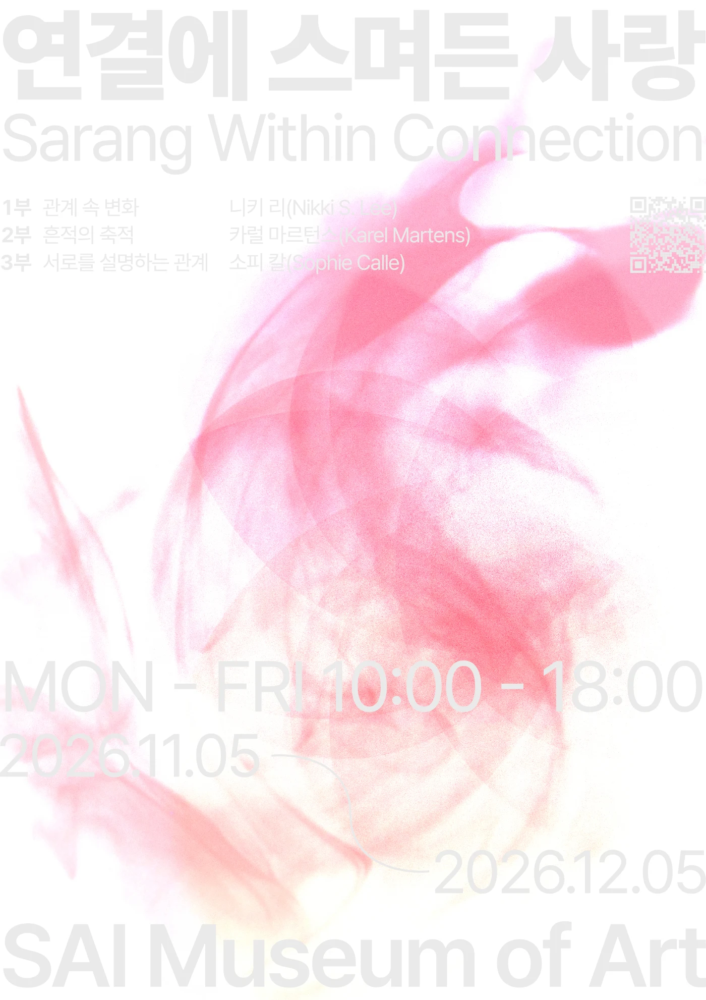 |
| **05 잉크 B** | **06 잉크 C** | **07 하트 잎** | |
| 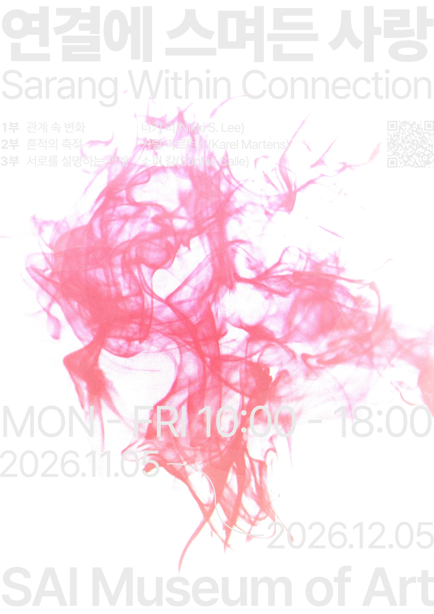 | 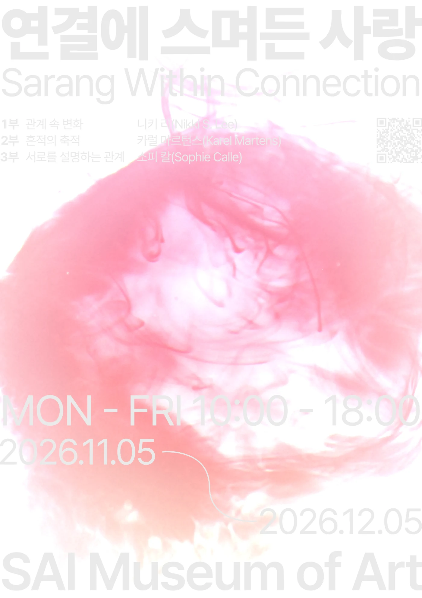 | 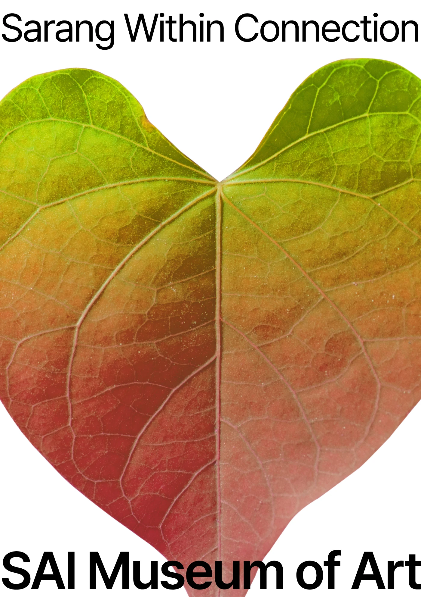 | |

공통 레이아웃: 위에 국문 제목과 영문 제목 **Sarang Within Connection**을 판면 폭에 꽉 채우고, 그 아래 전시 구성(1~3부) · 참여 작가 · QR, 아래쪽에 **MON - FRI 10:00 - 18:00**, 기간(2026.11.05 → 2026.12.05를 곡선으로 잇는다), 맨 아래 **SAI Museum of Art**.

- **01 꽃**: 팀 그래픽을 분홍으로 옮겼다. 타원 8개를 겹치고 블러와 그레인을 더해 가장자리를 흐렸다. 글자도 분홍
- **02 나뉜 원**: 큰 반투명 원들을 위아래 두 덩어리로 나누고 가운데를 비웠다. 글자는 흰색. 두 세계 '사이'를 여백으로 둔 안
- **03 꽃 + 붓 제목**: 01과 같고, 국문 제목만 획이 끊기고 번진 손글씨 느낌의 글자로 바꿨다
- **04 · 05 · 06 잉크**: 이미지 메이커의 물속 분홍 잉크 사진. 글자는 연회색으로 사진 뒤로 물러난다. 04는 흩날리는 결, 05는 가는 실처럼 퍼지는 결, 06은 둥근 구름
- **07 하트 잎**: 초록에서 빨강으로 물드는 하트 모양 잎 사진. 글자는 검정, 영문 제목과 미술관 이름만 남겼다

## 잎과 꽃: 그래픽 개념 다듬기

> 원 하나는 나와 이어진 한 사람의 세계다. 두 세계가 겹친 자리에 잎이 생기고, 우리는 그것을 사랑이라 부른다. 관계가 늘어날수록 잎이 늘어나고, 잎들이 모여 한 송이 꽃이 된다. 모든 잎이 모이는 가운데가 가장 밝다. 그곳이 지금의 나다.

- 정리 문서: [leaf-concept.md](leaf-concept.md) · 웹에서 직접 만져 보기: https://yongzu.github.io/VT/1030/leaf/
- 핵심: **꽃은 사랑이 아니라 한 사람이다. 사랑은 그 안의 잎이다.** 꽃이 연인으로 읽히는 문제를, 사랑을 복수(잎들)로 만들어 풀었다
- 정한 규칙: 잎 폭을 ±15% 안에서 다르게 · 수술 빼기 · 꽃을 확대한 화면은 '관계의 안쪽' · 밝아짐(검은 바탕)과 짙어짐(흰 바탕)은 같은 뜻이니 한쪽으로 통일
- 잎맥(지나간 관계의 흔적)은 다른 비주얼 컨셉으로 넘겨 보류했다
- 꽃형 구도 스터디: [flower-study/](flower-study/)
  - 크기 · 거리 · 간격을 모두 흐트러뜨리면 꽃이 무너진다(B)
  - '관계 하나 = 원 한 쌍'으로 놓으면 잎 하나가 정확히 나와 그 사람의 관계가 된다(I · J)
  - 다시 그리기: `node build.js`(`build2.js`, `build3.js`). `@napi-rs/canvas` 필요

| 첫 스터디 (A~D) | 두 가지 읽기 (E~H) | 정리 (I · J) |
| --- | --- | --- |
| 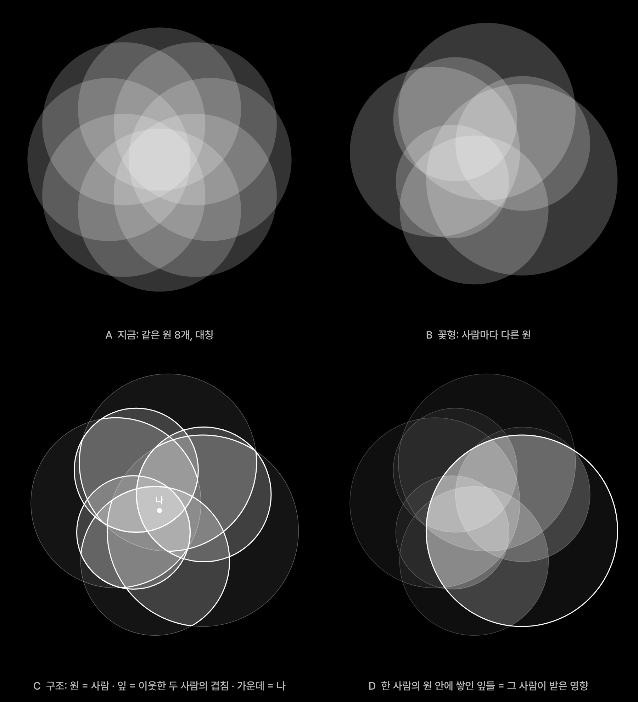 | 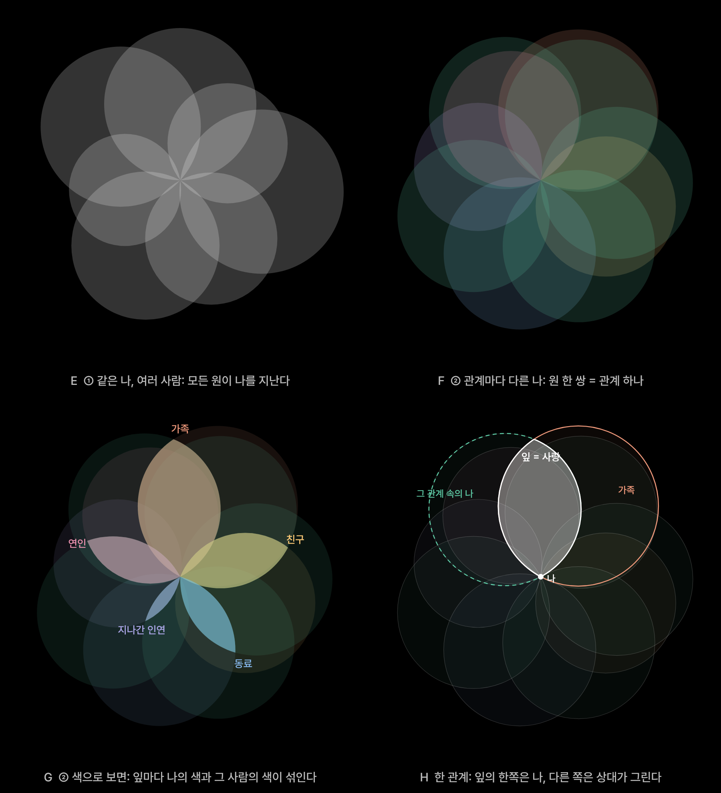 | 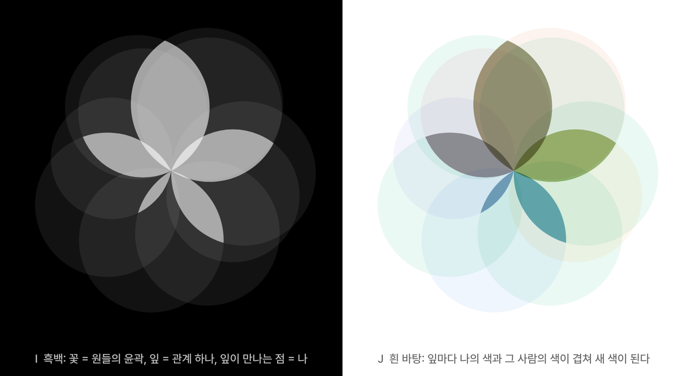 |

## 피드백 / 고민
- **밝아지는가, 진해지는가 (LO3)**: 팀 덱의 그래픽은 검은 바탕에서 '겹칠수록 **밝아진다**'고 설명하는데, 포스터 01 · 03은 흰 바탕에서 가운데가 더 **진한** 분홍이 된다. 둘 다 '쌓인다'는 뜻은 되지만, 발표에서 그래픽 설명과 포스터가 어긋나 보인다. 포스터에 맞춰 설명을 "겹칠수록 짙어진다"로 고칠지, 포스터를 밝아지는 쪽으로 바꿀지 정해야 한다
- **경계가 남아 있는가 (LO3)**: 01 · 03은 블러로 원의 윤곽이 거의 사라져 '스며듦(영향)'은 강하지만 '각자의 고유함(경계)'이 약하다. 02는 윤곽이 또렷해 경계는 살지만 번짐이 없다. 1022 도식에서 정한 규칙(바깥 윤곽은 선명하게, 겹친 자리만 번지게)을 다시 적용해 볼 수 있다
- **분홍 한 색 (LO1 · LO3)**: 분홍은 '사랑'을 바로 떠올리게 하지만, 기획은 사랑을 연인에 한정하지 않는다. 또 한 색이라 '서로 다른 두 세계'가 구분되지 않는다. 1022 도식처럼 원마다 다른 색을 주면 '어느 한쪽의 것도 아닌 새로운 색'(02 작가의 관점)까지 보여 줄 수 있다
- **잉크 사진 (LO2)**: 물에 퍼지는 잉크는 '스며듦 · 영향'을 가장 직접 보여 준다. 다만 잉크가 한 색이라 '두 세계가 만난다(겹침)'가 보이지 않는다. 두 색의 잉크가 만나 섞이는 장면을 다시 찍어 볼 수 있다. 글자가 연회색이라 제목과 기간이 잘 읽히지 않는다
- **하트 잎 (LO1 · LO3)**: 잎맥은 연결망으로, 초록에서 빨강으로 물드는 색은 스며든 흔적으로 읽힌다. 하지만 하트 모양은 연인 사이의 사랑으로 먼저 읽혀 1016에 고친 문제(보편성이 와닿지 않음)로 되돌아갈 위험이 있다
- **제목 글자 (LO4)**: 03의 붓 제목은 번짐을 글자에도 담지만 '연결에 스며든 사랑'이 한눈에 읽히지 않는다. 01의 고딕 제목과 무엇을 얻고 잃는지 비교해 고른다
- **원고와 다른 점**
  - 영문 제목: 덱 표지는 **Love** Within Connection, 원고와 포스터는 **Sarang** Within Connection. 포스터 기준(Sarang)으로 맞출지 확인한다
  - 관람 시간: 원고는 10:00 - 18:00, 포스터는 **MON - FRI**. 주말 휴관을 뜻하게 되므로 휴관일을 정해 원고에도 반영한다
  - 관객에게 건네는 질문 "당신 안에는 누구의 모습이 남아 있나요?"가 포스터에 없다. 1022에는 포스터 문구로 넣기로 했었다

## 글로벌 파일에 반영할 것
- [x] [POSTER.md](../POSTER.md) 팀 이름(Team SAI), 키워드 순서와 뜻, 그래픽 콘셉트, 포스터 초안
- [x] [README.md](../README.md) 날짜별 기록

## 다음 할 일
- [ ] 포스터 방향 고르기: 그래픽(꽃) · 이미지(잉크) · 둘을 합친 안. 기획 의도(겹침 · 영향 · 경계 · 흔적)를 근거로 고른다 (LO3)
- [ ] 겹친 자리가 밝아지는지 짙어지는지 정하고 그래픽 설명과 포스터를 맞추기
- [ ] 원의 윤곽(경계)과 번짐(영향)을 한 화면에 함께 두는 안 시도
- [ ] 영문 제목 Love / Sarang 통일, 휴관일, 포스터 문구(질문) 넣을지 정하기
- [ ] 잎과 꽃 규칙으로 덱 07 그래픽 다시 그리기, 덱 07 설명을 수정안으로 바꾸기 → [leaf-concept.md](leaf-concept.md#다음-할-일)
