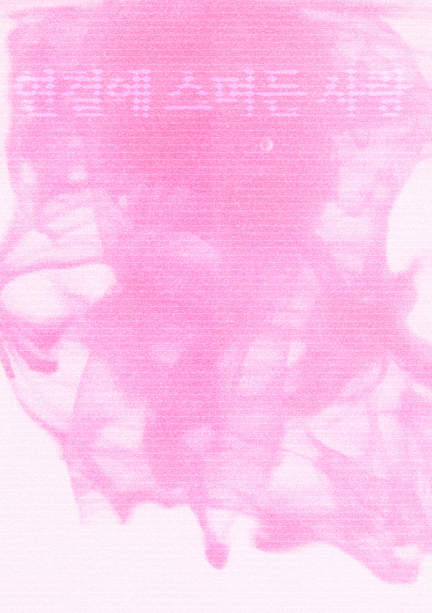
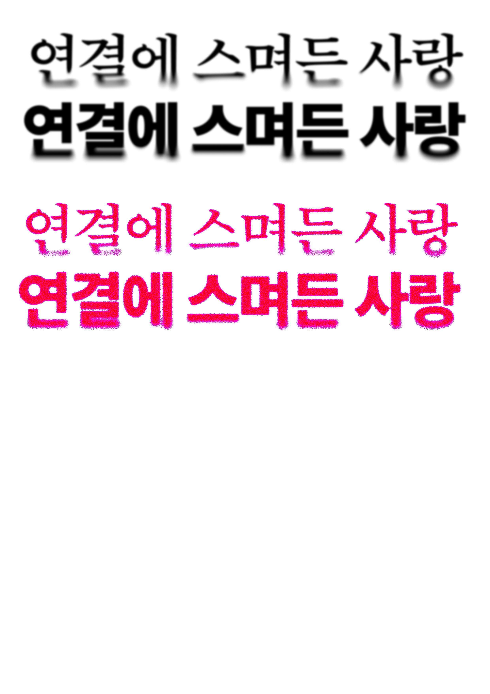

# 1102 — 포스터 타이틀 타이포그래피 실험 (WK08 WIP)

## 오늘 한 일
- 포스터 제목 「연결에 스며든 사랑 / Sarang Within Connection」을 효과별로 실험했다.
- 방향 4가지: 스며듦·입자, 유리, 하프톤, 기울기 블러
- 타이틀1(스며듦·입자)은 서체와 색을 바꾼 배리에이션을 28장 뽑았다 → [WIP/타이틀1/](WIP/타이틀1/)

## 결과물

| 타이틀1 스며듦·입자 | 타이틀2 유리 |
| --- | --- |
|  |  |

| 타이틀3 하프톤 | 타이틀4 기울기 블러 |
| --- | --- |
|  |  |

원본 PSD는 같은 폴더(`WIP/`)에 있다. `displacement.psd`와 `타이틀1.psd`도 함께 올렸다.
PSD는 Git LFS로 올렸으므로 다른 컴퓨터에서는 Git LFS를 설치한 뒤 받는다.

## 피드백 / 고민
-

## 글로벌 파일에 반영할 것
- [ ]

## 다음 할 일
- [ ]
