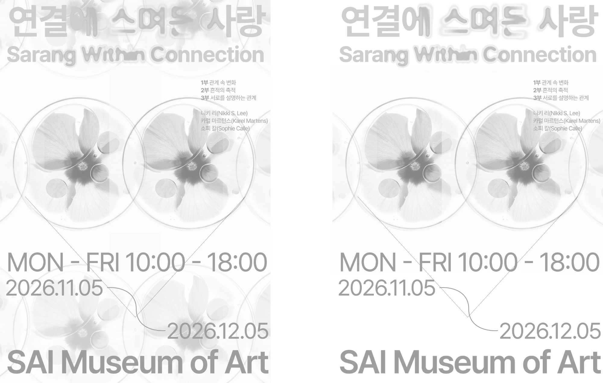
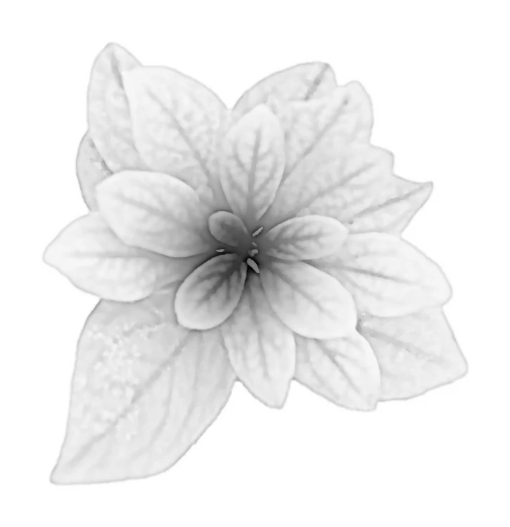
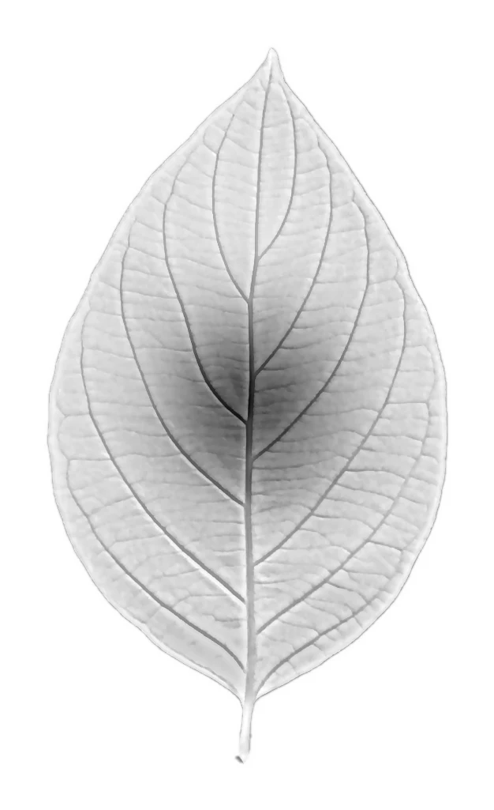
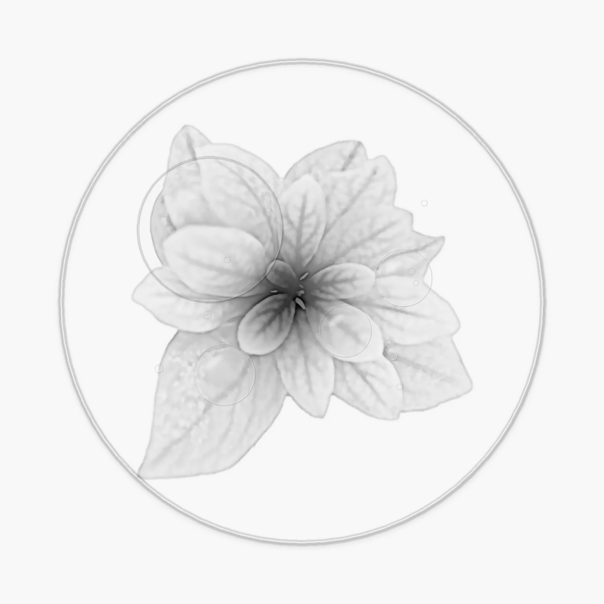
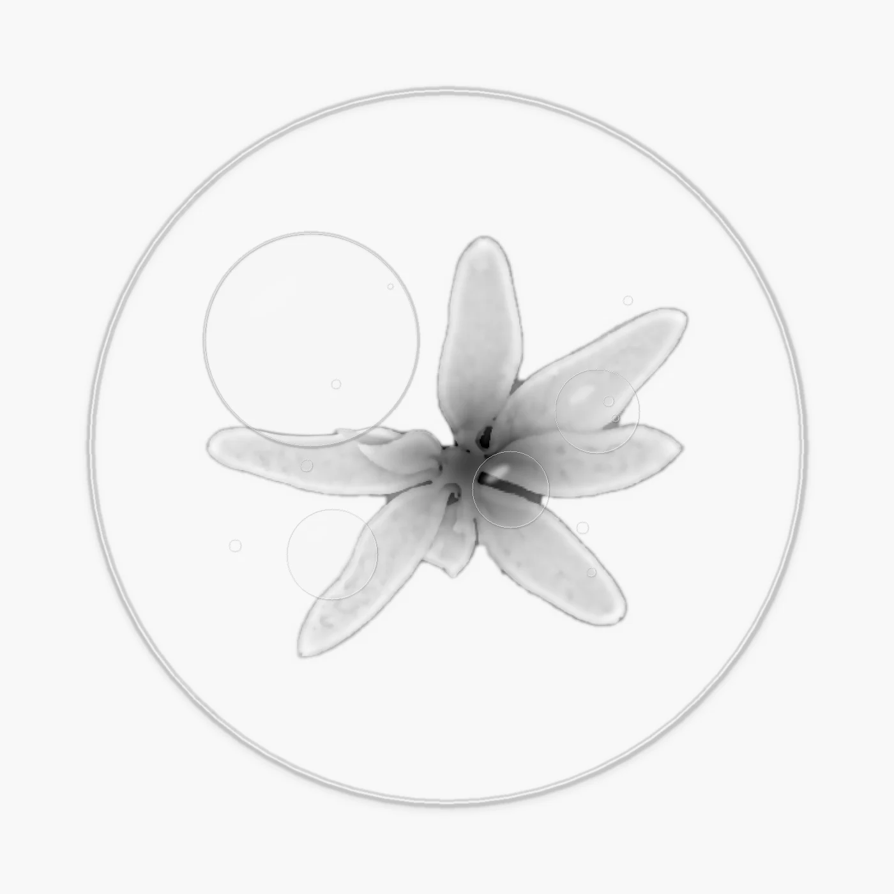
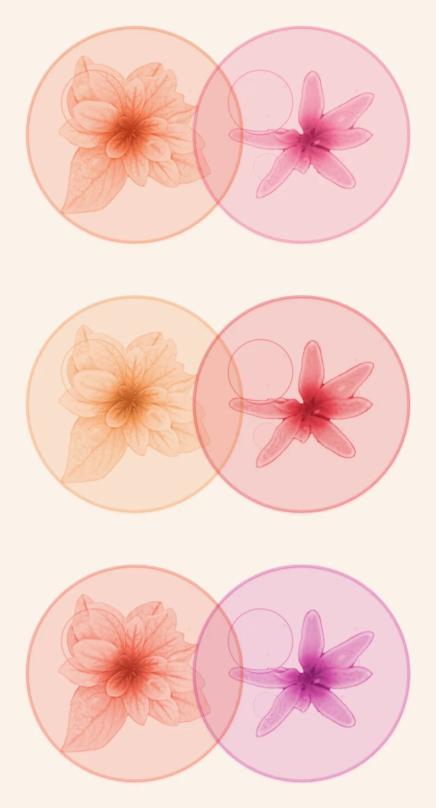
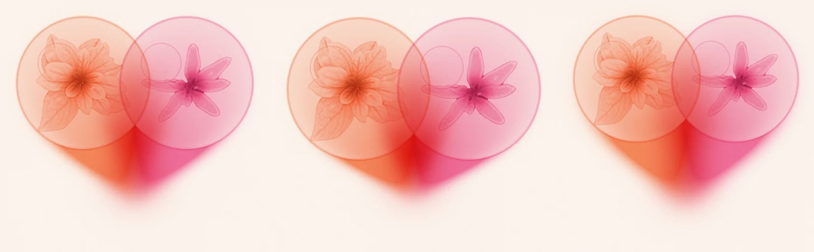

# 1110 — 포스터 방향 확정: 스며들어 생긴 하트 (WK08)

## 이어하기 (다른 PC · 다음 세션)

"1110 작업을 이어한다"고 하면 이 섹션부터 읽고 시작한다.

1. `git pull`을 실행한다. PSD가 있으므로 Git LFS가 설치돼 있어야 한다.
2. 파이썬 3.10 이상에서 아래 명령을 실행한다. 모든 결과물이 `xray/`에 PNG로 다시 만들어진다(PNG는 커밋하지 않음).
   ```bash
   pip install -r 1110/xray/requirements.txt
   bash 1110/xray/run_all.sh
   ```
3. **현재 위치**: 마일스톤 3(메인 그래픽 스터디)을 진행 중이다. 엑스레이 식물 → 웜톤 → 겹침 → 하트 꼬리까지 만들었다. 다음은 아래 [다음 할 일](#다음-할-일)이다.
4. **원본 사진**: 이미지 메이커가 찍은 식물 사진 원본은 작업 PC의 `Desktop\WK08\WIP\사진\`에 있다(2592×3872 PNG). 저장소에는 그중 4장을 2000px JPG로 줄여 `xray/src/`에 넣었다. 다른 식물을 쓰려면 원본을 `src/`에 추가하고 `run_all.sh`에 한 줄을 더한다.

## 오늘 한 일

- 포스터 시안 두 개(1번 파동 · 2번 꽃잎) 가운데 **2번을 폐기**하고 1번을 발전시키기로 했다 → [drafts/01](drafts/01_poster-drafts-1-2.webp)
- 레퍼런스를 거쳐 컨셉을 정했다: **원 안의 식물 → 겹친 자리의 새 색 → 아래로 번져 모인 하트** → [컨셉](#컨셉)
- 주변 원은 따로 흩어 놓지 않고 **그리드**로 배치하기로 했다 → [drafts/02](drafts/02_grid-drafts.webp)
- 포토샵으로 투명한 식물(엑스레이 꽃) 효과가 잘 나오지 않아, **코드로 엑스레이 질감을 만드는 파이프라인**을 짰다 → [xray/](xray/)
- 웜톤 색 3세트를 칠하고 하트 꼬리 3종을 만들었다 → [결과물](#결과물)

## 결정

| 결정 | 이유 |
| --- | --- |
| 2번(잎사귀) 폐기 | 형태가 비슷하다는 점에만 기대서 납득되지 않는다. 보는 사람이 바로 이해하지 못하고 설명이 필요하다. 시각언어는 직관적으로 전달돼야 한다 |
| 1번 발전 | 원 · 겹침 · 교집합 · 파동 · 스며듦이라는 기존 방향에, 원이 반복되며 연결되는 루프 구조를 더한다 |
| 식물은 '모양'이 아니라 '내용'으로 | 원 안에 담긴 그 사람의 세계로 쓴다. 중심은 고유성, 잎은 다양한 측면이다. 2번을 폐기한 이유를 피해 간다 |
| 하트는 그리지 않고 생기게 한다 | 두 원의 번짐이 한 점에 모인 결과로 하트 실루엣이 생긴다. 하트 외곽선을 그리거나 겹친 자리를 하트로 오리면 상투적이고 경계가 깨진다 |
| 주변 원은 그리드로, 옅게 | 수많은 관계를 질서 있게 보여 준다. 가운데 두 원만 그리드에서 벗어나 겹치면서 대비로 강조된다. 연인으로만 읽힐 위험도 줄인다 |
| 웜톤 | 사랑의 온도. 이전 시안의 회청색은 버린다 |

## 컨셉

> **수많은 연결 속에서, 두 세계가 스며들어 사랑이 된다.**

| 요소 | 의미 | 키워드 |
| --- | --- | --- |
| 원 | 한 사람의 세계 | 연결 |
| 원 안의 식물(위에서 본 방사형) | 중심은 고유성, 잎은 다양한 측면 | 경계 |
| 서로 다른 두 웜톤 | 서로 다른 두 사람 | |
| 겹친 자리의 새 색 | 어느 한쪽의 것도 아닌 새로운 색 (서문) | 겹침 · 영향 · 스며듦 |
| 아래로 모이는 번짐 | 관계가 남긴 자국 | 흔적 |
| 번짐이 모여 생긴 하트 실루엣 | 사랑 | 사랑 |
| 주변 그리드의 옅은 원들 | 다른 식물을 담은 수많은 관계 | 연결 · 흔적 |

**조형 규칙**
- 식물은 원 안에서만 선명하고, 번지는 것은 색뿐이다. 고유성은 지키고 영향만 스며든다.
- 원 윗부분의 윤곽은 끝까지 남긴다(경계).
- 꼬리 끝으로 갈수록 따뜻하게 한다. '흘러내림'(슬픔)이 아니라 '모임'으로 읽히게 한다.
- 읽히는 순서: 하트 실루엣과 겹친 색 → 두 원 → 주변 원 → 식물 잎맥. 축소·흐림 테스트를 했을 때 하트만 남아야 한다.

**정보 과밀 대책**
- 요소마다 역할을 하나씩 맡긴다. 형태는 실루엣, 색은 의미, 식물은 질감이다.
- 디테일은 가운데 두 원에만 둔다. 주변 원은 5~7개로 하고 식물을 거의 지운다.
- 색은 배경, 웜톤 2색, 혼합색까지 4가지로 제한한다.
- 강한 대비는 겹친 자리에서 꼬리 끝까지 한 줄기에만 쓴다.
- 그래픽이 이미 번짐을 말하므로 제목 효과(1102)는 절제한다.
- 빼기 테스트 후보: 주변 원, 원 윤곽, 그레인, 잎맥, 물방울

**레퍼런스** (저작권 자료라 저장소에 올리지 않음)
- 위로 번지는 꼬리가 달린 붉은 원 하나(그라데이션 블러). '연결 + 스며듦'을 가장 직관적으로 보여 줘서 메인 그래픽의 바탕으로 삼았다.
- 반투명 동심원이 쌓인 붉은 수채 원들. 겹침과 파동, 비워 둔 원을 참고했다.
- 두 동심원이 위아래로 겹친 주황 그래픽. 교집합이 가장 진해지는 구조를 참고했다.
- 페트리 접시 안의 엑스레이 꽃(흑백, 유리 테두리, 물방울). 원 안의 식물 질감의 목표다.
- 엑스레이 꽃 작가 검색어: Steven N. Meyers, Albert G. Richards, Hugh Turvey, Nick Veasey, Brendan Fitzpatrick / 촬영 방법 검색어: `backlit leaf light pad`, `transillumination flower`, `scanography`

## 결과물

**포스터 시안 (작업 전)**

| 1번 · 2번 시안 | 그리드 시안 |
| --- | --- |
|  |  |

**엑스레이 변환** (`xray.py`, `dish.py`): 손 제거 → 밀도 변환 → 잎맥 · 경계 · 중심 → 유리 접시와 물방울

| x_0230 | x_0178 | d_0230 | d_0222 |
| --- | --- | --- | --- |
|  |  |  |  |

**웜톤과 겹침** (`color.py`): 위부터 주황-분홍, 살구-빨강, 코랄-마젠타. 겹친 자리에 혼합색이 생긴다.



**하트 꼬리** (`tail.py`): 왼쪽부터 기본, 짧은 꼬리, 긴 꼬리와 부드러운 번짐



## 파이프라인 (`xray/`)

| 파일 | 하는 일 | 조절할 값 |
| --- | --- | --- |
| `xray.py` | 녹색만 골라 손과 배경을 지운다. 명암을 밀도로 바꿔 반투명 잎, 진한 잎맥, 겹친 잎 경계, 짙은 중심을 만든다 | `P` 딕셔너리(d0 바탕 밀도, dc 중심 밀도, dv 잎맥, de 경계, dr 윤곽). 잎맥이 반대로 나오면 세 번째 인자로 `flip` |
| `dish.py` | 유리 접시 테두리, 렌즈 물방울(구형화), 작은 기포 | 물방울 위치 리스트. 네 번째 인자를 주면 물방울을 뺀다 |
| `color.py` | 밀도를 웜톤 그레이디언트 맵으로 칠하고 원 안을 옅게 물들인다. 두 접시를 곱하기로 겹친다 | `SETS`(색 조합), `TINT`(원 안 색 농도) |
| `tail.py` | 두 원의 색이 아래 한 점으로 번지고, 가운데에서 혼합색이 함께 흐른다. 끝을 가장 따뜻하게 한다 | `tip_k` 꼬리 길이, `blur` 번짐, `k_tail` · `k_mix` 농도, `inside` 원 안 번짐 |
| `run_all.sh` | 위 순서를 한 번에 실행하고 `results/`에 webp 미리보기를 만든다 | |

## 피드백 / 고민

- **색**: 주황-분홍이 기획에 가장 맞는다. 웜톤 안에서 두 사람의 차이와 따뜻한 혼합색이 함께 산다. 살구-빨강은 한쪽이 무겁고, 코랄-마젠타는 차갑게 읽힐 수 있다.
- **꼬리**: 하트는 '보일 듯 말 듯'이어야 하므로 기본과 짧은 꼬리 사이가 적정선이다. 긴 꼬리는 하트가 기호처럼 굳는다(LO4).
- **꼬리 아래쪽 경계**: 두 색의 경계가 희미하게 남아 있다. 서로 다른 두 사람이 끝까지 구분된다는 뜻으로 둘지, 더 섞을지 정해야 한다.
- **식물 위치**: 식물이 원 중앙에 있어서 교집합 안에서 잎끼리 겹치지 않는다. 식물을 서로 가까이 당겨야 '측면이 스며든다'가 보인다.
- **물방울**: 아직 의미가 없다(LO3). '내 안에 스며든 타인의 흔적'으로 정하고 렌즈 안만 상대 색으로 물들이거나, 뺀다.
- **위험**: 원 두 개와 하트는 연인으로 읽히기 쉽다. 1016에 슬로건을 바꾼 이유와 같다. 그리드의 주변 원이 그 균형을 맡는다.
- **촬영**: 지금 사진은 손에 든 측면 사진이라 투명감에 한계가 있다. 라이트 패드 위에서 위에서 내려다보며 노출을 높여 찍은 투과광 사진이면 결과가 훨씬 좋아진다(이미지 메이커에게 요청).

## 글로벌 파일에 반영할 것
- [x] POSTER.md: 1110 방향(스며들어 생긴 하트)과 2번 폐기 이유

## 다음 할 일

마일스톤 (현재 3번 진행 중)
1. [x] 소스 정리: 누끼, 손 제거 (코드로 처리)
2. [x] 색 체계: 식물마다 웜톤 듀오톤, 가운데 두 색과 혼합색 → 주황-분홍 추천
3. [ ] 메인 그래픽 스터디: 원 간격, 꼬리 길이, 블러로 하트가 보일 듯 말 듯한 지점 찾기. 식물을 교집합 쪽으로 당기기. 꼬리 아래 두 색 경계 결정
4. [ ] 주변 원 그리드: 다른 식물(src에 추가)로 원을 만들어 그리드에 옅게 배치하고 가운데 집중도를 확인. 주변 색을 꼬리에 얼마나 섞을지 정하기
5. [ ] 포스터 합성: 타이틀(1102 스며듦·입자 계열, 절제), 정보 블록, 축소·흐림 테스트
6. [ ] 점검과 확정: 연인으로만 읽히지 않는지, 조형 선택을 기획 의도로 설명할 수 있는지(LO3), 멈출 시점(LO4)
