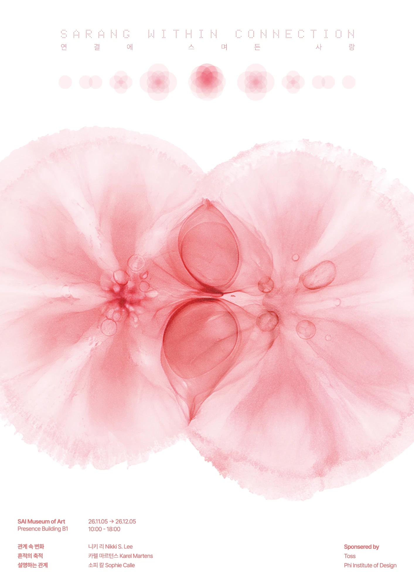

# 기획안 - 연결에 스며든 사랑

전시 포스터 공동 과제. TEAM 04 · **Team SAI (사이)**: 이가은 · 임창균 · 조용주(그래픽 메이커)

- 제출 슬라이드 ①~⑤: [1013/slides](1013/slides/)
- 웹페이지(임시): [WK05/](WK05/) → https://yongzu.github.io/VT/WK05/
- 발표 슬라이드 1920×1080 (yongzu.github.io/BI 스타일, 그래픽 없음)
  - 압축판 6장: [WK05/deck/](WK05/deck/) · [PDF](WK05/deck/VT05_TEAM04.pdf) · [PNG](WK05/deck/png/)
  - 전체판 10장 (WK06 발표용, 마지막 장은 팀원 스케치용 빈 장): [WK05/deck-full/](WK05/deck-full/) · [PDF](WK05/deck-full/VT05_TEAM04_full.pdf) · [PNG](WK05/deck-full/png/)
- 팀 덱 개편(Figma, 글자를 줄이고 도식으로): 프로젝트 컨셉 도식 · 서문 · 작가 소개와 전시 구성 → [1022/slides](1022/slides/)
- WK07 팀 덱 8장(표지 · 컨셉 · 서문 · 작가 · 원고와 구성 · 키워드 · 스케치 · 그래픽) → [1030/deck](1030/deck/)
- 포스터 초안 7종 → [1030/poster](1030/poster/) · [시각화](#시각화-그래픽과-포스터-초안--1030)
- 1110 방향: 스며들어 생긴 하트. 엑스레이 식물 원 · 웜톤 겹침 · 하트 꼬리 → [1110](1110/) · [아래 요약](#포스터-방향-스며들어-생긴-하트--1110)
- **최종 포스터 (1112)**: 수채로 번진 두 원 · 원 안의 엑스레이 잎 · 겹친 자리에서 핀 새 잎. 하트 꼬리는 뺐다 → [1112](1112/) · [아래 요약](#최종-포스터-겹친-자리에서-핀-새-잎--1112)
- **최종 기획서** 16페이지 PDF → [1112/final/proposal.pdf](1112/final/proposal.pdf) · [페이지 미리보기](1112/#최종-기획서)

## 확정 제목

**연결에 스며든 사랑** / Sarang Within Connection → [1013](1013/)

- 제목만 고정이다. 플랫폼이 준 전시 개요 초안과 제안 작가는 예시이므로 바꿀 수 있다.

## 주제의식

> **우리는 수많은 사람과 연결되면서 서로의 세계에 스며들고, 그 흔적들이 쌓여 지금의 자신을 이룬다.** (메인 슬로건) → [1016](1016/)

- 1016에 바꿨다. 사랑이 연인 사이만이 아니라 **모든 관계에 해당하는 보편적인 경험**이라는 점이 관객에게 바로 와닿지 않았다. 이전 메인 주제의 '좋아하는 마음'과 '서로의 세계'는 연인 한 사람으로 먼저 읽혔고, 보편성은 03 중간에 묻혀 있었다.
- 새 슬로건은 '수많은 사람'으로 범위를 열고, '스며들고(영향) → 흔적 → 쌓여(겹침)'로 키워드를 한 문장에 담는다. '경계'는 '각자의 고유함을 간직한 채'로 서문이 맡는다.
- 관객에게 건네는 질문은 그대로 둔다: **"당신 안에는 누구의 모습이 남아 있나요?"**

이전 주제의식 (1013) → [1013](1013/)
- 메인 주제: 사랑의 깊이는 좋아하는 마음의 크기가 아니라, 서로의 세계가 스며든 넓이다
1. 사랑의 깊이는 좋아하는 마음의 크기가 아니라, 서로의 세계가 겹친 넓이다
2. 벤다이어그램처럼 수학적으로 딱 나뉘는 것이 아니라, 스며들고 번지면서 서로에게 연결된다
- '겹친 넓이'를 '스며든 넓이'로 바꿔 두 주제의식을 한 문장에 담았었다. 넓이는 남기되, 선을 그어서가 아니라 번져서 생긴 넓이다.

## ① 전시 제목 및 콘셉트 기획 → [슬라이드](1013/slides/01_concept.webp)

**연결에 스며든 사랑** / Sarang Within Connection
이가은 · 임창균 · 조용주

**01 / 주제와 질문**
이 전시는 사랑을 연인 사이의 감정에 한정하지 않고, 가족과 친구, 지나간 인연 등 다양한 관계 속에서 서로에게 영향을 주고받는 과정으로 바라본다. **우리는 수많은 사람과 연결되면서 서로의 세계에 스며들고, 그 흔적들이 쌓여 지금의 자신을 이룬다.** 두 세계는 만나는 자리에서 선을 긋듯 나뉘지 않고 조금씩 번지며 섞이고, 그 자리에 남은 흔적은 우리를 이전과는 다른 존재로 만든다. 작가들은 이렇게 쌓인 흔적을 통해 사랑이 서로에게 어떤 변화를 남기는지 묻는다. 그리고 그 물음을 관객에게 건넨다. "당신 안에는 누구의 모습이 남아 있나요?"

**02 / 작가의 관점**
작가는 관계를 완성된 상태가 아니라 계속 진행 중인 과정으로 보고, 그 과정이 남긴 흔적에 주목한다. 두 세계가 만나는 자리에서는 서로의 습관과 언어, 기억이 천천히 스며들어 어느 한쪽의 것도 아닌 새로운 색이 생겨난다. 우리는 타인과 함께하며 서로를 닮아가지만, 동시에 이전에는 몰랐던 자신의 모습과 새로운 가능성을 발견하기도 한다. 작가는 이러한 변화를 단순히 서로 닮아가는 현상이 아니라, 각자의 고유함을 간직한 채 서로의 세계를 넓혀가는 과정으로 바라본다.

**03 / 관계와 맥락**
우리는 수많은 사람과 연결되어 살아가지만, 그 연결이 자신에게 무엇을 남겼는지는 쉽게 인식하지 못한다. 누군가에게서 배운 말투, 함께하며 생겨난 취향, 무심코 닮아 버린 습관처럼 흔적은 일상 곳곳에 남아 있다. 그 흔적은 사랑이라 부르지 않았던 관계에서도 생겨나고, 관계가 끝난 뒤에도 쉽게 사라지지 않는다. 자신의 것이라 여겼던 취향과 가치관 속에서 타인의 흔적을 발견하고, 우리가 누구와 연결되어 왔는지를 돌아보는 일은 곧 자기 자신을 이해하는 또 다른 방법이 된다.

**04 / 대상 관객**
이 전시는 '나'라는 사람을 이해하고 싶은 이들을 위한 전시다. 자신의 취향과 가치관이 어디서 시작되었는지 궁금한 사람, 지금의 나를 이룬 것이 무엇인지 돌아보고 싶은 사람에게 타인에게서 받은 흔적을 되짚어 볼 기회를 건넨다. 관객은 전시를 통해 자신의 말투와 취향, 습관 속에 남아 있는 누군가의 모습을 떠올리고, 그 흔적들이 쌓여 지금의 자신을 이루고 있음을 발견하게 된다. 나아가 타인과의 연결을 돌아보는 경험이 자기 자신을 새롭게 이해하는 계기가 되기를 기대한다.

- 01 · 03 · 04는 1016 최종본으로 바꿨다 → [1016](1016/). 02는 최종본 슬라이드에 04와 같은 글이 들어가 있어 1013 문안을 그대로 두었다(확인 필요).

### 제목 해석 (발표 슬라이드 ①에 넣음)
과제 양식은 "제목을 어떻게 해석했는지"를 묻는다. 처음 제출 슬라이드 01~04에는 없어서 발표 슬라이드 ①에 넣었다.

우리는 제목의 세 단어를 하나의 관계로 읽었다. **연결**은 나와 타인이 각자의 세계를 서로에게 열어 공유하는 일이다. **스며든**은 그 공유가 선으로 딱 나뉘는 교집합이 아니라, 번지고 섞이며 경계가 흐려지는 방식으로 일어난다는 뜻이다. **사랑**은 그렇게 스며든 넓이다. 그래서 우리는 사랑을 연결 바깥에 있는 특별한 감정이 아니라, 연결 안에 이미 스며 있는 것으로 해석했다.

- 전하고 싶은 생각: 내 것이라 여긴 말투와 취향, 습관 속에 타인이 있다. 타인을 돌아보는 일은 곧 나를 이해하는 일이다.
- 전하고 싶은 감각: 익숙한 나의 모습에서 문득 누군가를 발견하는 순간의 낯설고도 따뜻한 느낌.

### 프로젝트 컨셉 도식 (팀 덱, 1022) → [슬라이드](1022/slides/01_concept-diagram.png)
> 이 전시는 "사랑"을 연인 사이의 감정에 한정하지 않고, 가족과 친구, 지나간 인연 등 다양한 관계 속에서 서로에게 영향을 주고받는 과정으로 바라본다. 우리는 수많은 사람과 연결되면서 서로의 세계에 스며들고, 그 흔적들이 쌓여 지금의 자신을 이룬다.

- **연결 Connection**: 나의 세계(말투 · 취향 · 습관)와 타인의 세계(가족 · 친구 · 연인 등)가 겹친 자리가 **사랑 Love**(서로에게 영향을 주다, 스며들다)
- **흔적 Trace**: 서로에게 스며든 흔적 → **나의 세계를 이룬다**
- 도식 작업 과정과 조형 근거 → [1022](1022/)

## ② 전시 서문 및 참여 작가 목록 → [슬라이드](1013/slides/02_preface.webp) · [1022 개정 슬라이드](1022/slides/02_preface.png)

**연결에 스며든 사랑**
**우리는 수많은 사람과 연결되면서 서로의 세계에 스며들고, 그 흔적들이 쌓여 지금의 자신을 이룬다.** (1022 개정, 이전 머리 문장: 사랑의 깊이는 좋아하는 마음의 크기가 아니라, 서로의 세계가 스며든 넓이다.)

**이 전시는 사랑을 연인 사이의 특별한 감정에 한정하지 않고, 다양한 관계 속에서 서로의 세계에 스며들며 각자의 삶을 변화시키는 과정으로 바라본다.** 우리는 살아가며 수많은 사람과 연결된다. 가족과 친구, 연인, 그리고 한때 가까웠지만 지금은 멀어진 사람들까지. 서로 다른 삶이 연결되는 순간, 우리는 상대의 세계에 발을 들이고 서로의 말과 생각, 행동에 영향을 주고받으며 변화한다.

누군가에게서 배운 말투, 함께하며 생겨난 취향, 무심코 닮아버린 습관처럼 연결의 흔적은 일상 곳곳에 남아 있다. 우리는 관계를 맺으며 상대의 일부를 자신의 삶에 받아들이고, 동시에 자신의 일부를 상대의 삶에도 남긴다. 서로의 세계가 겹치고 스며드는 과정에서 우리는 조금씩 닮아가지만, 각자의 고유함을 간직한 채 이전에는 몰랐던 자신의 모습을 발견하기도 한다.

하지만 우리는 수많은 연결을 통해 자신에게 무엇이 스며들었는지 쉽게 알아차리지 못한다. 자신의 것이라고 여겼던 취향과 가치관 속에도 누군가의 말과 행동, 함께한 시간이 남아 있다. 이 전시는 서로의 세계에 스며들어 남겨진 흔적을 되짚으며, 타인과의 연결을 돌아보는 일이 곧 지금의 자신을 이해하는 또 다른 방법이 될 수 있음을 이야기한다.

전시장을 걷는 동안 이 질문에 천천히 답해 보길 바란다.
당신 안에는 누구의 모습이 남아 있나요?

- 1016 최종본 → [1016](1016/). 참여 작가 문단은 최종본에 넣지 않았다(아래 쟁점 참고).

### 참여 작가

선정 기준: 작품 하나가 아니라 **연작이나 프로젝트**로 주제를 다뤄 온 작가. 키워드를 작가마다 나눠 맡기지 않고 전시 전체로 본다.

**카럴 마르턴스 (Karel Martens)** · 대표 작업: 모노프린트 연작, 『Tokyo Papers』 · 키워드: 겹침 · 흔적
1939년 네덜란드에서 태어난 그래픽 디자이너이자 예술가다. 타이포그래피, 북디자인, 교육 등 다양한 분야에서 활동해 왔다. 누군가 사용했던 종이 위에 색과 형태를 반복해서 찍어내는 모노프린트 작업으로 잘 알려져 있다. 오래된 기록 위에 새로운 흔적을 쌓으며, 서로 다른 시간과 이미지가 만나 만들어내는 우연한 아름다움을 탐구한다. 그의 작업은 타인의 흔적 위에 자신의 색이 더해지며 새로운 세계가 탄생한다는 전시의 메시지와 맞닿아 있다.
- 출처: [Wikipedia](https://en.wikipedia.org/wiki/Karel_Martens) · [Carpenter Center](https://carpenter.center/exhibitions/karel-martens-monoprints) · [Tokyo Papers](https://draw-down.com/products/tokyo-papers-karel-martens)

**김애란 (Kim Ae-ran)** · 대표 작업: 산문집 『잊기 좋은 이름』 (열림원, 2019) · 키워드: 흔적 · 영향
1980년생 소설가로, 『두근두근 내 인생』, 『비행운』, 『바깥은 여름』 등을 집필했다. 일상에서 마주하는 사람들의 삶과 감정을 섬세한 언어로 풀어내며, 평범한 순간에 깃든 관계의 의미를 발견한다. 첫 산문집 『잊기 좋은 이름』에서는 자신을 지나온 사람과 풍경, 기억을 돌아보며 지금의 자신을 이루는 수많은 이름을 불러낸다. 타인을 기억하고 이해하는 일이 곧 자신을 이해하는 과정이 될 수 있음을 이야기한다.
- 출처: [왓챠피디아 책 소개](https://pedia.watcha.com/ko/contents/b9j0qaK/book_description) · [Vogue Korea](https://www.vogue.co.kr/?p=191682)

**니키 리 (Nikki S. Lee)** · 대표 작업: 《Projects》 1997-2001, 《Parts》 2002-2005 · 키워드: 영향 · 경계 · 흔적
1970년생 한국 출신의 사진·퍼포먼스 작가이자 영화감독이다. 서로 다른 공동체에 직접 참여하며 자신의 외모와 행동을 변화시키고, 그 모습을 사진으로 기록하는 작업으로 알려져 있다. 대표작 《Projects》와 《Parts》를 통해 개인의 정체성이 고정된 것이 아니라 타인과의 관계 속에서 끊임없이 변화한다는 사실을 탐구한다. 그의 작품은 우리가 누군가와 함께하는 동안 서로의 일부를 받아들이며 이전과는 다른 존재가 되어가는 과정을 보여준다.
- 소개 관점: 본래 주제는 사랑보다 정체성과 사회적 관계다. 이 전시에서는 '타인과의 연결이 나를 어떻게 바꾸는가'라는 관점으로 읽는다.

작품 이미지는 저작권 자료라 저장소에 올리지 않는다(로컬 `1013/private/`).

**소피 칼 (Sophie Calle)** · 대표 작업: 《주소록》 The Address Book (1983) · 개념미술가 · 사진가 (1022 팀 덱 3부)
1953년 프랑스 파리에서 태어난 예술가로, 사진과 글을 통해 관계와 기억, 부재를 탐구한다. 대표작 《주소록》에서는 길에서 주운 주소록에 적힌 지인들을 만나 주인에 관해 질문하고, 여러 사람의 기억과 증언을 모아 한 사람의 모습을 구성한다.
- 선정 이유: 타인에게 남은 기억과 흔적을 통해 한 사람을 드러내는 작업 방식. 관객이 자신을 이루어 온 관계를 돌아보는 동시에, 자신 역시 누군가의 기억 속에 남아 있는 존재임을 생각하게 한다. 타인에게 받은 영향과 자신이 타인에게 남기는 흔적을 함께 살펴보려는 전시의 의도와 맞닿아 있다

### 전시 구성 (팀 덱 1022)

**관계 속 변화 → 흔적의 축적 → 서로를 설명하는 관계**: 전시는 세 부로 이어진다. 관계 속에서 달라지는 나에서 시작해, 겹겹이 쌓인 흔적을 지나, 나를 기억하는 사람들에게 닿는다.

| 부 | 작가 | 한 줄 |
| --- | --- | --- |
| 1부 관계 속 변화 | 니키 리 | 우리는 누구와 함께하느냐에 따라 조금씩 다른 사람이 된다 |
| 2부 흔적의 축적 | 카럴 마르턴스 | 그렇게 만난 사람들의 흔적이 겹겹이 쌓여 지금의 나를 이룬다 |
| 3부 서로를 설명하는 관계 | 소피 칼 | 나를 설명하는 것은 나 자신만이 아니라, 나를 기억하는 수많은 사람들이다 |

- 마르턴스 선정 이유(팀 문안): 기록이 남아 있는 종이는 각자가 가진 고유한 세계이고, 그 위에 찍힌 도형은 바깥에서 온 물건이 남긴 자국이다. 관계를 맺은 사람이 떠나도 그 영향은 반투명한 색처럼 내 안에 겹쳐 남는다
- 흐름: 나의 변화(1부) → 내 안에 쌓인 타인(2부) → 타인 안에 남은 나(3부). 3부에서 시선이 뒤집혀 '내가 남기는 흔적'까지 다룬다
- 3부 작가는 김애란에서 소피 칼로 바뀌었다(팀 덱). 아래 ③ 원고와 ⑤ 결정 기록의 작가 목록은 1013 기준이다
- 구성은 팀 작가 장(1 · 2 · 3부)에서 다룬다. 한 장짜리 요약은 전시 구성을 빼고 **작가 소개**만 담았다 → [슬라이드](1022/slides/03_artists.png) · [1022](1022/)

## ③ 포스터에 들어갈 원고 → [슬라이드](1013/slides/03_poster-copy.webp) · [1022 팀 덱](1022/slides/04_poster-copy.png)

| 항목 | 내용 |
| --- | --- |
| 전시 제목 | 연결에 스며든 사랑 / Sarang Within Connection (WK07 원고와 포스터 초안은 Sarang, 덱 표지만 Love로 남아 있다 → [1030](1030/)) |
| 구성 | 1부 관계 속 변화 · 2부 흔적의 축적 · 3부 서로를 설명하는 관계 (WK07 원고에 추가) |
| 문구 | 당신 안에는 누구의 모습이 남아 있나요? (1022 팀 덱, 관객에게 건네는 질문을 포스터 문구로) |
| 전시 기간 | 2026.11.05 - 2026.12.05 (연도는 1022에 2026으로 채움) |
| 참여 작가 | 니키 리(Nikki S. Lee), 카럴 마르턴스(Karel Martens), 소피 칼(Sophie Calle) (1022 팀 덱 기준, 1013에는 김애란) |
| 장소 | 서울특별시 성동구 왕십리로14길 36 (성수동1가, 프리센스) / 36, Wangsimni-ro 14-gil, Seongdong-gu, Seoul, Republic of Korea |
| 주최·주관 | **SAI Museum of Art 사이미술관** - 두 세계 '사이'의 공간 |
| 협찬 | Toss, Phi Institute of Design |
| 관람 시간 | 10:00 - 18:00 (포스터 초안은 MON - FRI 10:00 - 18:00, 휴관일 정해야 함) |
| 기타 | QR코드 - 웹사이트 / SNS |

미술관 이름 후보 (가상): 스밈미술관(SEUMIM Museum, '스며듦') · 번짐미술관(BEONJIM Art Museum, 키워드 '번짐') · **사이미술관(SAI Museum of Art, 두 세계 '사이'의 공간)** · 겹미술관(GYEOP Museum, 키워드 '겹침') · 물듦아트센터(MULDEUM Art Center, 서로에게 물든다) · 결미술관(GYEOL Museum, 관계의 결, 마음의 결)

## ④ 시각화 핵심 키워드 → [슬라이드](1013/slides/04_keywords.webp)

| 키워드 | 전시의 의미 | 시각화 방향 |
| --- | --- | --- |
| **영향** (Influence) | 서로 다른 두 세계가 만나 각자의 모습에 변화를 일으키는 것. 상대의 말과 행동, 생각이 나에게 스며들어 이전과는 다른 모습을 만들어 내는 과정 | 한쪽의 형태가 다른 쪽에 의해 휘거나 변형되는 모습, 색이 주변으로 번져 나가는 블러, 서로의 움직임에 따라 달라지는 형태 |
| **흔적** (Trace) | 관계가 지나간 뒤에도 남는 변화, 즉 말투와 습관과 취향 | 얼룩, 지문, 찍힌 자국, 지워졌지만 남아 있는 선처럼 무언가 '있었음'을 보여 주는 이미지 |
| **경계** (Boundary) | 하나가 되지 않고 "각자의 고유함을 간직한다"는 관점 | 선명한 윤곽선과 흐려진 부분을 한 화면에 대비해, 섞였지만 사라지지 않은 상태 |
| **겹침** (Overlap/Layer) | 서로 다른 두 세계가 만나는 자리, 전시의 출발점. 여러 사람과의 관계 속에서 자신의 정체성이 형성된다 | 반투명한 두 도형이 포개지는 레이어, 색이 겹치는 부분만 진해지는 오버프린트 |

- 제목 단어인 '사랑'과 '연결'은 전시 전체를 가리키는 말이고 너무 추상적이라 키워드에서 뺐다 (LO1 OE3)
- WK07 팀 덱에서 순서를 **겹침 → 영향 → 경계 → 흔적**으로 바꾸고 뜻을 한 줄로 줄였다 → [슬라이드](1030/deck/05_keywords.webp) · [1030](1030/)
  - 겹침: 서로 다른 삶이 만나고 여러 관계가 쌓이며 나의 정체성이 형성된다
  - 영향: 서로의 말과 행동, 생각이 스며들며 각자의 모습을 변화시킨다
  - 경계: 서로에게 스며들면서도 각자의 고유함을 간직한다
  - 흔적: 관계가 지나간 뒤에도 말투와 습관, 취향 속에 서로의 일부가 남는다

## 시각화: 그래픽과 포스터 초안 → [1030](1030/)

**그래픽 콘셉트** → [슬라이드](1030/deck/07_graphics.webp)
> 반투명한 원 하나는 한 사람의 세계이고, 원이 겹친 자리일수록 밝아진다. 원이 반복적으로 겹쳐 가며 가장 많이 겹친 가운데가 가장 밝아지고, 겹침이 쌓여 하나의 꽃이 된다. 수많은 연결이 남긴 흔적이 쌓여 지금의 나를 이룬다는 전시의 메시지를 형태로 옮긴 그래픽이다.

- 1022 컨셉 도식(두 원 → 겹친 자리 → 흔적)을 이어받아, 원 2개 → 4개 → 8개 → 꽃으로 늘렸다
- **잎과 꽃으로 다시 읽기 (1030)**: 원 = 나와 이어진 한 사람의 세계, 겹친 자리 = 잎(관계 하나, 사랑), 잎들이 모인 전체 = 꽃(한 사람의 관계 전체), 가장 밝은 가운데 = 나. "꽃은 사랑이 아니라 한 사람이다. 사랑은 그 안의 잎이다." → [leaf-concept.md](1030/leaf-concept.md) · [웹](https://yongzu.github.io/VT/1030/leaf/)
  - 규칙: 잎 폭 ±15% · 수술 빼기 · 확대 화면 = 관계의 안쪽 · 밝아짐/짙어짐 통일. 잎맥은 다른 컨셉으로 보류
- 키워드별 손 스케치 24칸 → [슬라이드](1030/deck/06_sketches.webp)

**포스터 초안 7종** (1030)

| 방향 | 초안 | 표현 |
| --- | --- | --- |
| 그래픽 | 01 꽃 · 03 꽃 + 붓 제목 | 분홍 타원 8개를 겹치고 블러 · 그레인으로 번지게 했다. 03은 국문 제목을 끊기고 번진 글자로 |
| 그래픽 | 02 나뉜 원 | 큰 반투명 원을 위아래로 나누고 가운데를 비웠다. 흰 글자 |
| 이미지 | 04 · 05 · 06 잉크 | 물속에 퍼지는 분홍 잉크 사진, 연회색 글자 |
| 이미지 | 07 하트 잎 | 초록에서 빨강으로 물드는 하트 모양 잎, 검정 글자 |

- 공통 레이아웃: 위 국문 · 영문 제목(판면 폭에 꽉 채움), 그 아래 구성 · 작가 · QR, 아래 관람 시간 · 기간(곡선으로 잇는다) · SAI Museum of Art
- 정할 것 (LO3): 겹친 자리가 **밝아지는지(덱 설명) 짙어지는지(포스터)** · 블러로 사라진 원의 윤곽(경계) · 분홍 한 색이 연인의 사랑으로 좁게 읽히는 문제 · 하트 모양의 같은 위험 · 잉크가 한 색이라 '두 세계의 만남'이 안 보이는 점 → [1030 피드백](1030/#피드백--고민)

## 포스터 방향: 스며들어 생긴 하트 → [1110](1110/)

> **수많은 연결 속에서, 두 세계가 스며들어 사랑이 된다.**

- **원** = 한 사람의 세계. 원 안에는 그 사람만의 **식물**을 엑스레이처럼 투명하게 담는다. 중심은 고유성, 잎은 다양한 측면이다.
- **가운데 두 원**: 서로 다른 두 웜톤(추천: 주황 · 분홍)이 겹친 자리에서 **새 색**이 된다(서문의 "어느 한쪽의 것도 아닌 새로운 색").
- **꼬리**: 번진 색이 아래 한 점에 모여 **하트 실루엣**이 된다. 하트는 그리지 않고, 스며든 결과로 생긴다.
- **주변 원**: 다른 식물을 담은 수많은 관계를 **그리드**로 옅게 배치한다. 가운데로 집중시키고 연인으로만 읽히는 것을 막는다.
- **규칙**: 식물은 원 안에서만 선명하고 번지는 것은 색뿐이다 · 원 윗부분 윤곽은 남긴다(경계) · 꼬리 끝이 가장 따뜻하다(흘러내림이 아니라 모임)

**2번 시안(잎사귀) 폐기 이유**: 형태가 비슷하다는 점에만 기대서 납득되지 않는다. 보는 사람이 설명 없이 이해할 수 없다. 시각언어는 직관적으로 전달돼야 한다(LO2 · LO3).

- 남은 쟁점: 꼬리 아래 두 색의 경계를 남길지 · 식물을 교집합 쪽으로 당기기 · 물방울의 의미 · 주변 그리드의 밀도 → [1110 피드백](1110/#피드백--고민)

## 최종 포스터: 겹친 자리에서 핀 새 잎 → [1112](1112/)

> 식물이 스며든 물과 빛으로 자라듯, 우리도 수많은 사람에게서 스며든 말투와 개성, 취향이 쌓여 지금의 자신이 된다.

- **왜 식물인가**: 생김새가 아니라 **사는 방식**이 같다. 식물은 바깥에서 스며든 것으로 자라고, 잎맥은 스며든 물이 지나간 길이다. 형태 유사성에 기대 폐기한 2번 시안과 다르다
- **원**: 도형이 아니라 젖은 종이에 번진 물감. 바깥 경계는 고유함, 겹친 자리는 가장 진하다
- **겹친 자리의 새 잎**: 어느 한쪽의 것도 아닌 새로운 것 = 사랑. 1110의 '새 색'을 형태로까지 넓혔다
- **하트 꼬리를 뺐다**: 잉크가 한 줄기로 떨어져 해파리처럼 보였고, 하트를 잡으려 하면 기호처럼 굳었다. 사랑은 새 잎이 맡는다
- **상단의 원 행**: 주변 그리드 대신 수많은 연결을 한 줄로 보여 준다(1030 그래픽 원 2 → 4 → 8 → 꽃을 이어받음)
- 남은 일: 참여 작가 항목 갱신(김애란 → 소피 칼) → [1112 피드백](1112/#피드백--고민)

## 주제 공식 (출발점) → [1013](1013/)

> 나와 대상의 연결 = 세계의 공유 = 사랑
> 교집합의 크기 = 스며드는 정도 = 관계의 깊이

- 사람은 각자의 세계를 가지고 있고, 관계를 맺으면 타인의 세계에 들어간다. 겹치는 부분이 연결 지점이자 서로 스며드는 곳이다
- 이후 '수학적으로 딱 나뉘는 교집합'이 아니라 **번지며 스며드는 겹침**으로 고쳐 잡았다 (주제의식 2)

## ⑤ 주요 의사결정 및 토론 요약 → [슬라이드](1013/slides/05_decisions.png)

1차 회의(10/12 23:06, 46분)와 2차 회의(10/13 00:20, 71분), 이후 작가 탐색과 원고 정리까지 이가은 · 임창균 · 조용주 세 사람이 함께 정했다.

### 방향을 정한 기준
1. **관객이 무엇을 느끼고 가져가는가.** 혼자 봐도 남는 것이 있어야 한다.
2. **한 갈래로 간다.** 여러 트랙을 나란히 두면 전시가 갈라진다.
3. **제목의 '스며든'이 보이는가.** 사랑은 보이지만 스며듦이 보이지 않는 안은 발전시키거나 버렸다.
4. **읽히는 말을 쓴다.** 로맨스 소설 같은 표현과 수사적 표현을 피했다. 전문가가 수사적 서문을 나쁜 사례로 든 것을 근거로 삼았다.
5. **시각으로 옮길 수 있는가.** 키워드는 이미지와 그래픽으로 발산할 수 있는지를 따졌다.

### 결정의 흐름

| 단계 | 결정 | 정한 방식 |
| --- | --- | --- |
| 제목 | 생성된 후보 가운데 「연결에 스며든 사랑」 | 다른 후보는 키워드를 나열해 뜻이 잘 읽히지 않았다 |
| 주제 발산 (1차) | 7개 안 가운데 '세계의 교집합' | 토론으로 좁혔다. 클리셰 우려는 있지만 가장 낫다고 합의 |
| 공식 (1차) | 나와 대상의 연결 = 세계의 공유 = 사랑 / 교집합의 크기 = 스며드는 정도 = 관계의 깊이 | 전원 동의 |
| 주제의식 (2차) | '서로의 일부가 된다'와 '서로에게 번져 간다'를 합치고, '겹친 넓이가 넓을수록 사랑이 깊다'를 더함 → 최종 '스며든 넓이' | 각자 AI로 뽑은 문장을 비교하고 합쳤다 |
| 질문 (2차) | "당신 안에는 누구의 모습이 남아 있나요?" | 가은 제안, 전원 동의 |
| 개요 구조 (2차) | 01 주제와 질문 · 02 작가의 관점 · 03 관계와 맥락을 살리고 04 대상 관객을 추가 | 01·02는 어느 전시에서나 보는 형식이라 살렸다. 대상 관객이 빠져 있어 더했다 |
| 개요 작성 (2차) | 01은 세 사람의 초안 중 하나를 고르고, 02 가은 · 03 용주 · 04 창균이 나눠 쓴 뒤 용주가 통합 | 분업 후 통합 |
| 작업 순서 (2차) | 콘셉트와 서문을 먼저, 참여 작가는 그다음 | 콘셉트에 맞는 작가를 찾아야 한다 |
| 서문 (2차) | 수사를 덜어 평서문으로 | 전문가 피드백 |
| 시각화 키워드 (2차 이후) | **영향 · 흔적 · 경계 · 겹침** | AI가 낸 후보와 팀이 더한 후보에서 소거법으로 줄였다 |
| 작가 탐색 기준 | 작품 하나가 아니라 **연작이나 프로젝트**로 주제를 다뤄 온 작가. 키워드를 작가마다 나눠 맡기지 않고 전시 전체로 본다 | 탐색 중 기준을 고쳤다 |
| 참여 작가 | **니키 리**, **Karel Martens**, **김애란** | 니키 리는 다른 공동체에 스며들며 바뀌는 자신을 기록해 '스며드는 과정'을 보여 준다. Martens는 타인의 흔적 위에 색을 겹쳐 새 색을 만든다. 김애란 『잊기 좋은 이름』은 나 → 너 → 우리로 넓어지는 구성과 "잊기 좋은 이름은 없다"는 결론이 흔적과 질문에 맞는다 |
| 미술관 이름 | **사이미술관 (SAI Museum of Art)** - 두 세계 '사이'의 공간 | 후보 6개(스밈, 번짐, 사이, 겹, 물듦, 결) 중에서 골랐다 |
| 포스터 원고 | 11/05 ~ 12/05 · 성수동 · 10:00-18:00 · 협찬 Toss, Phi Institute of Design | 가상 정보로 정리 |
| 메인 슬로건 (1016) | **우리는 수많은 사람과 연결되면서 서로의 세계에 스며들고, 그 흔적들이 쌓여 지금의 자신을 이룬다.** 01 · 03 · 04와 서문을 이에 맞춰 다시 썼다 | '모든 관계의 보편적인 경험'이 직관적으로 다가오지 않는다는 문제를 팀이 짚었다. 관계 예시를 넣은 안, 뺀 안을 비교한 뒤 팀이 문장을 정했다 → [1016](1016/) |

### 검토했지만 택하지 않은 대안

| 안 | 이유 |
| --- | --- |
| 애착 물건 | 세대 간 연결(물려 내려오는 것)로 흡수됐다 |
| 연결의 방식 3트랙 (세대 간 / 관계와 교감 / 기술적 연결) | 셋을 다 하면 전시가 세 갈래로 갈라지고 벅차다. 하나만 고르기로 했다 |
| 연결의 정도 (싱크 맞추기가 아닌 이해하기) | 사랑은 보이지만 '스며듦'이 안 보인다. '세계의 교집합'으로 발전했다 |
| 모든 연결을 다시 생각하기 (충전기, 목줄, 생명유지장치) | 너무 1차원적이다. 재치 요소로 남긴다 |
| "사랑하는 존재의 흔적이 스며들어 있다" 같은 문장 | 로맨스 소설 같은 표현이라 거부감이 든다 |
| "하나가 된다" | 요즘 사람들은 관계를 하나가 되는 것보다 서로 존중하고 이해해 가는 과정으로 여긴다 |
| 퍼즐처럼 맞춰 간다 | 외곽을 설계해 딱 맞추는 느낌이다. 시간을 함께 보내며 습관이 번져 가는 쪽을 택했다 |
| 키워드 '반투명', '축적' | 소거법으로 뺐다. 축적은 '겹침'이 더 맞는 말이라 겹침으로 옮겼다 |
| 키워드 '번짐' | 블러로만 흐르기 쉽다. 더 넓은 '영향'을 택하고, 번짐은 영향의 표현 방법(블러)으로 남겼다 |
| 키워드 '고유함' | 시각화하기 어렵다. 스펀지 비유(색은 섞여도 스펀지는 각자 남는다)를 '경계'로 옮겼다 |
| 키워드 '확장' | 시각화하면 크기가 커지는 것 정도만 떠오른다 |
| 김이나 『보통의 언어들』 | '나의 언어로 나를 지키는' 책이라 '타인이 내 안에 스며든다'는 주제와 방향이 반대다 |

### 의견이 갈린 지점과 결정 방식
- **세대 간 연결의 보편성** (1차): 특수해서 공감대가 좁다(용주) ↔ 엄마 방식대로 부엌을 정리하는 것도 세대 간 연결이다(가은) → 세대 간 연결을 따로 세우지 않고, 사랑의 범위를 가족·친구·지나간 인연으로 넓혀 안에 담았다
- **'서로의 일부'와 '번져 감' 중 무엇으로 갈까** (2차): 서로의 일부가 더 특징적이다(용주) ↔ 습관이 번져 가는 것으로 보자(창균) → 가은이 "서로의 일부가 되는 방식이 번져 가는 것"이라고 정리해 둘을 합쳤다
- **주제의식을 한 문장으로 쓸까** (2차): 한 문장이 좋다(용주) ↔ 나눠도 된다(가은, 창균) → 메인 문장 하나와 주제의식 두 개를 함께 두었다
- **작가의 관점 마지막 문장** (2차): 관계에 초점을 둔 안 ↔ 개인에 초점을 둔 안(가은이 고민) → 관계는 03에서 충분히 다루므로 02는 개인 쪽으로 정했다. "고유함을 간직한 채 서로의 세계를 넓혀 가는 과정"으로 마무리했다
- **서문은 얼마나 읽혀야 하나** (2차): 전시 서문은 원래 잘 안 읽힌다(가은) ↔ 의도가 전달되도록 잘 읽혀야 한다(용주) → 전문가 피드백을 근거로 읽히는 평서문을 택했다
- **참여 작가와 콘셉트 중 무엇이 먼저인가** (2차): 작가 목록부터(가은) ↔ 콘셉트를 먼저 정하고 그에 맞는 작가를 찾는다(용주) → 콘셉트와 서문을 먼저 썼다
- **키워드 '번짐'과 '영향'** (2차): 번짐은 블러로만 흐르기 쉽고 이전 과제와 겹친다, 영향이 상위 개념이라 발산하기 좋다(창균, 가은) ↔ 번짐이 주제와 더 직접 이어진다(용주) → 영향을 키워드로 두고, 번짐은 영향의 표현 방법으로 설명에 넣었다
- **'고유함'과 '경계'** (2차): 스펀지 두 개가 맞닿으면 색은 섞여도 스펀지는 각자 남는다(가은) → 고유함은 시각화하기 어려워 '경계'로 표현하기로 했다
- **가장 핵심인 키워드 하나** (2차): 흔적(창균) ↔ 겹침(용주) → 하나로 줄이지 않고 네 개를 모두 두었다. 겹침을 '전시의 출발점'으로 설명했다

### 아직 결정하지 못한 쟁점
- **서문의 참여 작가 문단**: 니키 리 · Karel Martens · 김애란이 왜 한 전시에서 만나는지 써야 한다. 김애란에게 약했던 '서로 스며드는 과정'은 니키 리가 채운다
- **매체 운용**: 드로잉 · 사진 · 출판물을 골랐다. 지금 작가는 사진(니키 리), 인쇄(Martens), 글(김애란)이다. 드로잉을 어떻게 담을지는 정하지 않았다
- **부정(−) 요소**: 개요와 서문에는 넣지 않았다. 그래픽에서 다룰지 정해야 한다
- **포스터 원고**: 휴관일, 연도, QR이 연결할 웹사이트와 무빙 포스터 제작 여부
