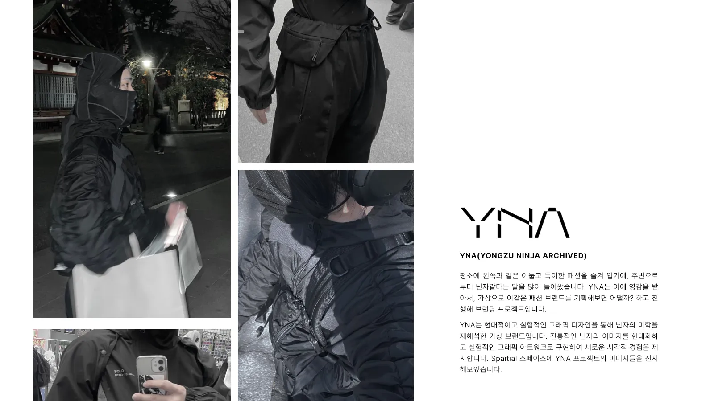
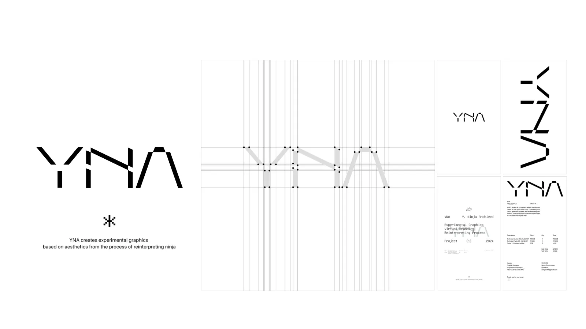
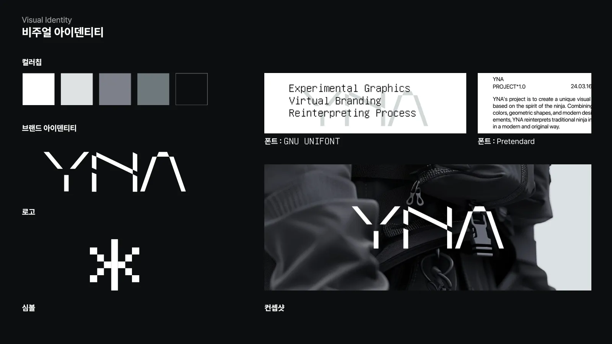

# 1117 — 매거진 과제 시작 (1회차: 기획안 · 경험일지 · 제안서)

> 마감 **11.17(화) 23:59** · 지각 마감 11.18(수) 23:59 · 마감 뒤에는 제출할 수 없다
> 제출: http://go.phi.design/vt/assignment

## 이번 과제가 하는 일

최종 매거진을 만들기 전에 **무엇을, 누구에게, 어떤 흐름으로** 소개할지 정리하는 단계다.

## 제출물 체크리스트

### ① 1pager 기획안 → [onepager.md](onepager.md)
- [ ] 좋아하는 주제, 좋아하게 된 구체적인 경험, 이 매거진의 관점
- [ ] 기본 정보: 매거진 이름, 150자 내외의 주제와 기획 의도
- [ ] 콘텐츠 구성: 꼭 다룰 것 / 뺄 것, 콘텐츠마다 제목 · 핵심 내용 · 형식(인터뷰 · 에세이 · 가이드 등) · 필요한 원고와 자료
- [ ] 편집기획안: 16p 목차. 페이지마다 내용, 분량, 글 · 사진 · 그래픽 필요 여부, 페이지 사이의 흐름 점검
- [ ] 디자인 컨셉: 16p 전체를 관통하는 컨셉 글 (키워드는 선택)

### ② 경험일지 → [journal.md](journal.md)
- [ ] 주제를 직접 경험한 뒤 작성
- [ ] 관찰하고 발견한 것, 느낀 점
- [ ] 콘텐츠 · 이미지 · 그래픽 기획에 쓸 단서 표시

### ③ 그래픽 과제: 제안서 → [proposal.md](proposal.md)
- [ ] 형식: **PDF · 1920 × 1080px(16:9) · 10페이지 이내 · 100MB 이하**
- [ ] 기획안 (①과 같은 내용)
- [ ] 제호 스케치: 이름의 성격을 담을 글자 형태와 배치 방향을 여러 가지로. 완성 로고가 아니라 표현 가능성 탐색
- [ ] 페이지네이션 스케치: 표지 · 뒤표지 포함 16p 썸네일, 페이지마다 내용과 이미지 · 글의 관계
- [ ] 폰트 선정: 제목 · 소제목 · 본문 · 캡션 폰트, 폰트 소개와 고른 이유

## 진행할 때 기억할 것 (과제 안내 요약)

- **좋아하는 이유에서 시작한다.** 유명한 이유나 공식 소개보다, 직접 경험하고 관찰한 장면을 먼저 본다
- AI를 쓰기 전에 **내 생각으로 먼저 쓴다.** 도구를 쓰더라도 내가 이해하고 설명할 수 있는지, 사실과 출처가 맞는지 확인한다
- **읽는 흐름을 설계한다.** 파편적인 아이디어나 시각적 임팩트보다, 독자가 어디서 흥미를 느끼고 무엇을 이해한 뒤 다음 장으로 넘어가는지
- 이미지와 그래픽을 **처음부터 같이** 고민한다. 구상만이 아니라 실제 작업 과정까지 남긴다

## 루브릭으로 보면 (CLAUDE.md 기준)

| LO | 이번 단계에서 확인할 것 |
| --- | --- |
| LO1 해석 | 이 매거진이 전하려는 것을 한 문장으로 말할 수 있는가? 다룰 것과 뺄 것을 이유와 함께 가렸는가? |
| LO2 번역 | 매거진 이름과 컨셉을 보고 제호 · 이미지가 떠오르는가? 레퍼런스 없이 제호를 스케치할 수 있는가? |
| LO3 일관성 | 폰트 · 페이지 흐름 · 이미지 방향을 디자인 컨셉과 하나씩 연결해 설명할 수 있는가? |
| LO4 완성도 판단 | 16p 중 빼거나 합쳐도 되는 페이지가 보이는가? 흐름이 끊기는 지점을 찾을 수 있는가? |

## 오늘 한 일
- `magazine/` 프로젝트 폴더와 1117 날짜 폴더를 만들고 과제를 정리했다
- 주제를 정했다: **검정 옷** (실험적이거나 미니멀한 무채색). 매거진 이름은 **YNA — Yongzu Ninja Archive**
- 2024 브랜딩 프로젝트 YNA를 참고 이미지로 남겼다 → [ref/](ref/)
- [1pager 기획안](onepager.md): 주제 · 경험 · 관점, 150자 기획 의도, 콘텐츠 7개, 16p 편집기획안, 디자인 컨셉 '숨어서 드러나기'
- [경험일지](journal.md): 지금까지의 경험은 정리했고, 옷장 펼쳐 보기 · 매장 방문은 칸만 만들었다
- [제안서](proposal.md): 기획 부분(1–6p) 원고 완료
- 기획설계 슬라이드 6장을 Figma에 만들었다 (VT_MAG_1 페이지, `YNA_01`–`YNA_06`, 템플릿 프레임 양식) → [Figma](https://www.figma.com/design/dhXKmqQ2FMSZ3c0VEWETej/Phi-Design-Institute?node-id=3130-7005). 폰트는 Noto Sans KR로 들어가 있어 Pretendard로 바꿔야 한다
- (1118) 바뀐 원페이저로 새 슬라이드 9장을 만들었다. 예전 `YNA_01`–`09`는 그대로 두고 아래 줄에 `YNA2_01`–`YNA2_09` → [Figma](https://www.figma.com/design/dhXKmqQ2FMSZ3c0VEWETej/Phi-Design-Institute?node-id=3163-7021). 07 · 09는 예전 것을 복제, 08은 썸네일 라벨을 새 16p 흐름으로 바꿨다

| YNA 소개 (2024) | 로고 | 아이덴티티 |
| --- | --- | --- |
|  |  |  |

## 피드백 / 고민
- 과제 안내: 글에서도 내 문체를 드러낼 것. 원고는 내 말투로 다시 다듬는다
- 경험일지 【 】 칸은 내가 실제로 겪은 것으로 채워야 한다

## 글로벌 파일에 반영할 것
- [x] 주제 · 이름 · 핵심 전달 내용 → [../README.md](../README.md)

## 이어하기
- 1118: 제호 스케치, 페이지네이션 스케치, 폰트 선정 → [proposal.md](proposal.md) 7–9p
- 경험일지 【 】 칸 채우기 (옷장 펼쳐 보기, 매장 방문)

## 다음 할 일
- [x] 주제 정하기
- [x] 1pager 기획안 초안
- [ ] 경험일지 【 】 채우기 (옷장 · 매장)
- [ ] 제호 스케치 (손으로, 여러 방향)
- [ ] 16p 페이지네이션 썸네일 스케치
- [ ] 폰트 4종 고르고 이유 쓰기
- [ ] 제안서 PDF(1920 × 1080, 10p 이내) 만들어 제출
